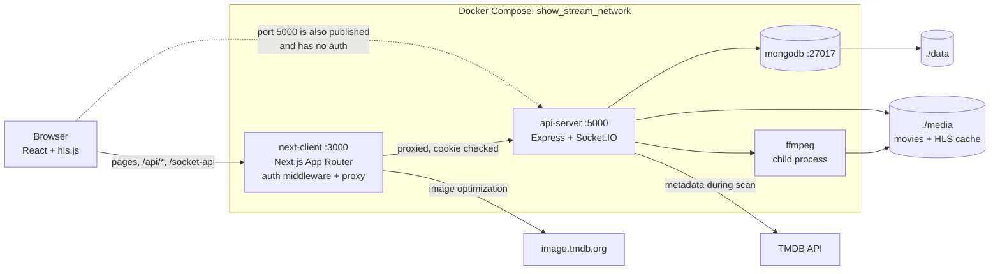
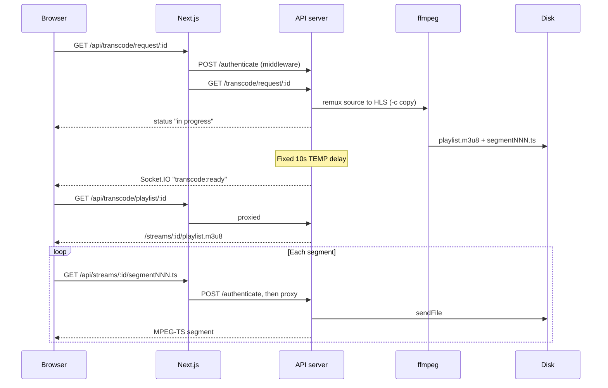

# ShowStream Repository Audit

| | |
|---|---|
| **Audit date** | 2026-10-31 |
| **Revision** | `ad6f8a3` on `main` (clean tree; the only commit in the history) |
| **Project version** | `0.0.1` (pre-alpha) |
| **Scope** | All tracked source and configuration, plus a running copy of the stack |

## 1. Summary

ShowStream is a self-hosted web media server, intended to replace Jellyfin. It is a TypeScript monorepo with an Express API, a Next.js web client, MongoDB, and ffmpeg.

**The core loop works for movies.** In a real browser, a user can log in, browse the library, press Play, and watch an H.264/AAC `.mp4` over HLS. The code builds and typechecks, and the movie browser (search, sort, filters) is the most finished part.

**It is not safe to host yet, and it is well short of replacing Jellyfin.**

- **Do not expose it to any network until the [P0 findings](#p0--critical-fix-before-running-on-any-network) are fixed.** The locked Next.js and React versions have a CVSS 10.0 unauthenticated remote code execution vulnerability. The API on port 5000 also has no authentication at all.
- **A single bad video file crashes the API server**, and that title then stays stuck as "in progress" even after a restart.
- **The "transcoder" does not transcode.** It repackages the file without re-encoding (`-c copy`), so a video only plays if the browser already supports its codecs. Only `.mp4` files are accepted, so `.mkv` libraries do not work at all.
- **TV shows are placeholders.** There is no watch history, subtitle support, audio track selection, user management, or native client.

The foundation is still worth keeping. The codebase is small (about 3,100 lines of hand-written app code, excluding the vendored UI components), cleanly separated, and strictly typed. Section 9 gives a suggested order of work.

### How to read the evidence labels

| Label | Meaning |
|---|---|
| **[Tested]** | Observed by running the code (see [section 7](#7-verification-performed)) |
| **[Static]** | Established from a tool result or an exact file check, without running the behavior |
| **[Read]** | Concluded from reading the code; not exercised at runtime |

## 2. What the project is and does

ShowStream indexes a local folder of videos, fetches metadata from TMDB, and streams the videos to a web browser. It is deployed with Docker Compose as three containers.

### Intended user flow

1. The operator places movies in `media/movies/Movie Name (Year)/Movie Name (Year).mp4`.
2. The operator triggers a library scan by calling `GET /scan` directly. No UI does this.
3. The user logs in and browses the movie library.
4. The user presses Play. If the title is not prepared, the server converts the whole file to HLS in the background.
5. A toast announces when it is ready. The user presses Play again and watches.

### Feature status

| Area | Status | Notes |
|---|---|---|
| Login with JWT cookie | Working | **[Tested]** Single hardcoded `admin` account in practice |
| Movie scan and TMDB metadata | Partly verified | Folder parsing and failure handling tested; a real TMDB response was not (see [limits](#74-what-was-not-verified)) |
| Movie library: search, sort, filter | Working | **[Tested]** for load and render; individual filters **[Read]** |
| Movie detail page | Mostly working | Video/audio/subtitle info is hardcoded |
| HLS playback (H.264/AAC `.mp4`) | Working | **[Tested]** in Chromium |
| Real-time "ready" notifications | Working | **[Tested]** toast received over Socket.IO |
| Light/dark theme | Present | **[Read]** |
| Other formats (`.mkv`, `.avi`, ...) | Missing | **[Tested]** rejected with 400 |
| Real transcoding, quality levels | Missing | TODO in `video.ts:66-70` |
| TV shows | Placeholder | Routes render ID text only; `showScan` returns `[]` |
| Home, Search pages | Empty | Render nothing |
| Settings page | Placeholder | Prints the user object as JSON |
| SyncPlay (watch together) | Not started | `sync.ts` contains only a comment |

## 3. Architecture

### 3.1 System overview



Next.js is both the UI and the gateway: its middleware is the **only** place authentication is enforced, and its rewrites carry all API traffic. Every video segment therefore flows through the Next.js process. The dashed line is the central design flaw: Compose publishes the API port directly, which bypasses that gateway entirely.

### 3.2 Playback sequence



### 3.3 Monorepo layout

```text
show-stream/
├── apps/
│   ├── api-server/          Express API, Socket.IO, scanning, ffmpeg
│   │   ├── src/             index, server, auth, db, media, video,
│   │   │                    notification, log, sync (empty)
│   │   └── Dockerfile
│   └── next-client/         Next.js 15 App Router web UI
│       ├── app/             Routes: login, dashboard/*, video/[id]
│       ├── components/      Media browser, player, sidebar, forms
│       ├── hooks/           Zustand stores, filtering, API hooks
│       ├── lib/             Server actions (login, JWT), socket client
│       ├── middleware.ts    Auth gate for all routes
│       └── Dockerfile
├── packages/
│   ├── types/               Shared API and DB TypeScript types
│   ├── ui/                  shadcn/ui component library
│   ├── eslint-config/       Shared ESLint config
│   └── typescript-config/   Shared tsconfig presets
├── media/                   Compose-mounted library + demo generator
├── data/                    Compose-mounted MongoDB storage
├── docker-compose.yml
├── build-docker.sh          Creates the network, builds, starts
└── turbo.json, pnpm-workspace.yaml
```

| Area | Lines | Notes |
|---|---:|---|
| `apps/api-server/src` | 944 | |
| `apps/next-client` | 2,093 | TS/TSX only |
| `packages/types/src` | 97 | |
| `packages/ui/src` | 1,594 | Mostly generated shadcn components |

### 3.4 API server modules

| Module | Responsibility |
|---|---|
| `index.ts` | Loads env, connects the DB, creates the admin user, defines all routes |
| `server.ts` | Builds Express and Socket.IO; CORS, Helmet, body parsers |
| `auth.ts` | Register, login, JWT verification |
| `db.ts` | Mongoose schemas and connection helpers |
| `media.ts` | Library queries, folder scan, TMDB lookups |
| `video.ts` | ffmpeg job, playlist lookup, segment serving, transcode state cache |
| `notification.ts` | In-memory socket list and broadcast |
| `log.ts` | Winston (files + console) and Morgan HTTP logging |
| `sync.ts` | Comment only; planned SyncPlay |

`media.ts` and `video.ts` import each other. This is harmless today because the imports are only used at call time, but it signals that the boundary between them needs work.

## 4. Tech stack

Versions are the ones resolved in `pnpm-lock.yaml`, except where noted as a range or pin from a `package.json` or Dockerfile.

| Layer | Technology | Version |
|---|---|---|
| Language | TypeScript (strict, with `noUncheckedIndexedAccess`) | 5.7.3 |
| Runtime | Node.js | 22.15 Alpine in Docker; `>=20` in `engines` |
| Package manager / build | pnpm workspaces, Turborepo | 10.13.1, 2.4.4 |
| API framework | Express | 5.1.0 |
| Real-time | Socket.IO | 4.8.1 |
| Database | MongoDB + Mongoose | 7.0 image, 8.16.4 |
| Authentication | jsonwebtoken, bcryptjs | 9.0.2, 3.0.2 |
| Video | ffmpeg (Alpine package) via fluent-ffmpeg | 2.1.3, **deprecated** |
| Metadata | TMDB via tmdb-ts | 2.0.1 |
| Logging / security | Winston, Morgan, Helmet, CORS | 3.17.0, `^1.10.1`, 8.1.0, `^2.8.5` |
| Web framework | Next.js App Router, React | **15.3.1, 19.0.0 (vulnerable)** |
| Data fetching / state | SWR, Zustand | 2.3.3, 5.0.6 |
| Forms | React Hook Form, Zod | `^7.56.1`, 3.24.2 |
| Styling / components | Tailwind CSS, shadcn/ui, Radix, lucide | 4.0.6 |
| Player | hls.js | 1.6.2 |
| Deployment | Docker multi-stage builds, Compose | |
| Tooling | Prettier, ESLint | `^3.5.1`, `^9.20.1` |
| Helper script | Python 3 (`media/create_media_folders.py`) | Stdlib only |

`package.json` pins `next` to 15.2.0, but the `pnpm-workspace.yaml` override raises it, so **15.3.1 is what actually installs**. The config relies on that: `new URL(...)` in `images.remotePatterns` needs a Next.js 15.3 feature.

## 5. Technical details

### 5.1 HTTP API

All routes are on the API server. Through the client they are reachable at `/api/*`, which requires a valid cookie. **Directly on port 5000 every route is public.**

| Method | Path | Purpose |
|---|---|---|
| `POST` | `/register` | Create a user (marked TEMP; open to anyone) |
| `POST` | `/login` | Exchange credentials for a JWT |
| `POST` | `/authenticate` | Validate a JWT (used by middleware) |
| `GET` | `/scan` | Scan the media folder (a `GET` with side effects) |
| `GET` | `/movies` | All movie metadata |
| `GET` | `/movie/:id` | One movie |
| `GET` | `/shows` | All shows (always empty today) |
| `GET` | `/transcode/request/:id` | Start or check HLS preparation |
| `GET` | `/transcode/playlist/:id` | Get the playlist URL when ready |
| `GET` | `/streams/:id/:file` | Serve `.m3u8` and `.ts` files |

Socket.IO runs at path `/socket` and emits one event, `notification`, with type `transcode:ready`. It is broadcast to every connected client, and connections are not authenticated.

### 5.2 Data model (MongoDB)

| Collection | Key fields | Purpose |
|---|---|---|
| `users` | `username` (unique), `password` (bcrypt, cost 10) | Accounts |
| `media` | `id` (unique), `type` | Maps an ID to movie or show |
| `movies` | `id`, `path`, `metadata` (Mixed) | TMDB details, credits, images |
| `shows` | `id`, `path`, `metadata` | Unused |
| `transcodes` | `id`, `status`, `lastRequestDate` | `not ready`, `in progress`, `ready` |
| `metadatas` | `lastScanTime` | Scan timestamp; written but never read |

The media `id` is the **TMDB ID**. TMDB numbers movies and TV shows separately, so the same number can refer to one of each. Because `media.id` is unique, the current key cannot hold both. Resolve this before building shows.

### 5.3 Library scan

`mediaScan` in `apps/api-server/src/media.ts`:

1. Reads `<media>/movies` and matches each folder against `^(.*)\s\((\d{4})\)$` (`media.ts:120`). Folders that do not match are skipped without logging.
2. Searches TMDB by name and year and **takes the first result** (`media.ts:151-152`).
3. Fetches details, credits, and images sequentially for each movie. Crew is reduced to directors, and images to English-language ones.
4. Upserts the `media` and `movies` documents.

Scans are not incremental: every movie is looked up again each time. Removed files are never deleted from the database.

### 5.4 Video pipeline

The core is one ffmpeg job in `transcodeRequest` (`video.ts:73-97`):

```text
-c copy  -hls_time 6  -hls_playlist_type vod  -hls_list_size 0
-hls_flags independent_segments  -hls_segment_type mpegts  -f hls
```

- **`-c copy` is a remux, not a transcode.** The video and audio are copied unchanged into MPEG-TS segments. It is fast and cheap, but codec support depends entirely on the browser.
- **Preparation happens up front.** The entire file must finish before Play is possible, and a fixed 10-second `TEMP` delay is added afterwards (`video.ts:91-95`). A 20-second test clip took about 11 seconds. **[Tested]**
- **Output lives in `media/cache/<id>/`** and duplicates the size of the source. It is never evicted; `lastRequestDate` is recorded but unused.
- **The server accepts `.mp4` only** (`media.ts:280`) and uses the first match in the folder.
- **Stream selection is ffmpeg's default** because there is no `-map`, so a multi-audio file yields one audio track. **[Read]**
- **Status lives in MongoDB and an in-process cache** (`cachedTranscodings`).
- **Segment serving is protected against path traversal.** Encoded `..` attempts returned 400. **[Tested]**

The browser plays through hls.js, with native HLS as the fallback for Safari (`components/hls-player.tsx`).

### 5.5 Authentication

1. A Next.js server action calls `POST /login` (`lib/login.ts`).
2. The API verifies the bcrypt hash and signs a JWT containing `userId` and `username`.
3. The JWT is stored in an `authToken` cookie: `httpOnly`, `SameSite=Lax` (browser default), `Secure` off. **[Tested]**
4. `middleware.ts` validates the cookie on every request except `/login` and static assets, by calling `POST /authenticate`. This includes every proxied video segment.

There is no refresh flow, no logout, no roles, and no password change. The `.env.example` lifetime is 3,600 seconds.

### 5.6 Web client

- **Routing:** App Router. `/` redirects to `/dashboard`; the player is at `/video/[id]`, outside the dashboard layout.
- **Library state:** four Zustand stores (search, sort, filter selection, applied filter), shared through a React context in `dashboard/movies/layout.tsx`.
- **Filtering is entirely client-side.** The browser downloads the whole library and filters in memory.
- **Data refresh:** SWR polls with `refreshInterval: 1000`. SWR's request deduplication reduces this in practice; 2 requests were seen in a 5-second window. **[Tested]**
- **Images:** TMDB images are fetched through `next/image`.

### 5.7 Configuration

| Variable | File | Used by | Notes |
|---|---|---|---|
| `TMDB_API_READ_ACCESS_TOKEN` | `.env` | API | Required for scanning |
| `TMDB_API_KEY` | `.env` | Nothing | **Unused**, though the README says it is needed |
| `MONGO_DB_USERNAME`, `MONGO_DB_PASSWORD` | `.env` | API | Must match Compose |
| `JWT_SECRET`, `JWT_EXPIRES_IN` | `.env` | API | |
| `MONGO_DB_URL`, `PORT`, `NEXT_CLIENT_URL` | `.env.development`, `.env.production` | API | Tracked; no secrets |
| `MEDIA_FOLDER` | Not documented | API | Used by the scan only; see finding 13 |
| `API_SERVER_URL` | `.env.development`, `.env.production` | Client | Read at build time for rewrites, so changing it needs a rebuild |
| `NEXT_PUBLIC_MOVIE_DB_IMAGE_BASE_URL` | `.env.development`, `.env.production` | Client | Inlined at build time |

The API loads `.env` first, then the environment-specific file. dotenv does not override values, so `.env` wins on any conflict.

### 5.8 Deployment

`build-docker.sh` creates the external `show_stream_network`, builds both images, and starts Compose. Both Dockerfiles are multi-stage, use `turbo prune --docker`, and run as non-root users. The API image installs ffmpeg with `apk`.

| Service | Port | Volume |
|---|---|---|
| `api-server` | `5000:5000` | `./media` to `/app/apps/api-server/media` |
| `next-client` | `3000:3000` | None |
| `mongodb` | `27017:27017` | `./data` to `/data/db` |

All services use `restart: always`. There is no `depends_on`, health check, TLS, or reverse proxy. The script is not executable (mode 644), so run it with `bash build-docker.sh`.

## 6. Findings

Findings are numbered once across all priorities. Paths are relative to `apps/api-server/` for `src/...` files.

### P0 — Critical: fix before running on any network

**1. Unauthenticated remote code execution in Next.js/React.** **[Static]**
The lockfile resolves `next@15.3.1` and `react@19.0.0`, both affected by [CVE-2025-55182](https://nextjs.org/blog/CVE-2025-66478) (Next.js tracker CVE-2025-66478), rated CVSS 10.0. This is an App Router app, which is the affected configuration, and the official advisory lists no workaround. The fix for this release line is Next.js 15.3.6 or later. Next.js auth middleware is not a mitigation, and `pnpm audit` also reports further critical and high advisories against this `next` version, so move to the latest supported release rather than the minimum patch.

**2. The API has no authentication.** **[Tested]**
Compose publishes port 5000, and no API route checks a token. Without credentials, the test read the library, ran a scan, created a user, and downloaded a video segment. Middleware in Next.js cannot protect a port that bypasses it. Fix: remove the published port, **and** verify the JWT inside the API.

**3. Default `admin`/`admin` account created on every boot.** **[Tested]**
`src/index.ts:31` registers it unconditionally, and no feature exists to change the password. Combined with finding 2, anyone reachable can log in.

**4. MongoDB is published with `root`/`root`.** **[Read]**
`docker-compose.yml` hardcodes these credentials and publishes port 27017 to the host. Remove the port mapping and take the credentials from the environment.

**5. Secrets are baked into the API image.** **[Tested for prune; Read for image]**
`.dockerignore` excludes `.env.example` but not `.env`, and a test `turbo prune` copied `.env` into the pruned output. Because Compose passes no `env_file` or `environment` to the API, this is the only way the secrets reach the container. The JWT secret, Mongo password, and TMDB token therefore end up in the image. Exclude `.env` and inject it at runtime with `env_file`. Note that no secrets are committed to git. **[Static]**

### P1 — High: stability and data integrity

**6. A failed ffmpeg job crashes the API.** **[Tested]**
`ffmpeg()` has no `.on('error')` handler (`src/video.ts:73-97`), so Node treats the error event as an uncaught exception. Requesting playback of a corrupt `.mp4` killed the server. Any user who presses Play on one bad file takes streaming down for everyone until the restart completes.

**7. Failed or interrupted jobs stay stuck forever.** **[Tested]**
After the crash in finding 6 and a restart, the title still reported `in progress`, and new requests return early on that status (`src/video.ts:32`). The title cannot be played or retried without editing the database. A server restart during a job should leave the same state. **[Read]** Fix: record a `failed` state, and reset `in progress` records at startup.

**8. A malformed URL crashes the API without authentication.** **[Tested]**
`GET /streams/abc/x.ts` killed the server. `Number('abc')` gives `NaN`, Mongoose throws a `CastError`, and the route does not await `streamVideoFile` (`src/index.ts:100-103`), so Express 5 cannot catch the rejection and it becomes an unhandled rejection. One request is a denial of service, repeatable after each restart. Fix: `await` the call, and validate IDs at the route.

**9. MongoDB operator injection at login.** **[Tested]**
`/login` passes the body straight into `findOne` (`src/auth.ts:47`). Sending `{"username":{"$ne":null},"password":"admin"}` returned a valid token without naming a user. A correct password for the matched user is still required, so this is not a full bypass, but it should be fixed with string validation on the API.

**10. Sessions expire with no refresh.** **[Read]**
The token lasts one hour and there is no refresh flow, although `auth.ts` lists one in its header comment. Middleware checks every segment, so playback that outlasts the token should fail partway through a film. Add refresh, or use a longer session.

### P2 — Medium: correctness and performance

**11. API errors are discarded.** **[Tested]**
Routes do `res.status(status).json(data)` and ignore `error`, so failures return an empty body. For example, `GET /movie/999` returns 400 with nothing in it. The client then calls `response.json()` on that empty body, which should throw; the movie page would stay on its spinner. **[Read]**

**12. Dead database checks.** **[Read]**
`ensureDbConnection()` is async but is not awaited at `src/auth.ts:21`, `src/auth.ts:42`, `src/video.ts:170`, and `src/video.ts:188`. A Promise is always truthy, so these guards never fire.

**13. `MEDIA_FOLDER` is only half-implemented.** **[Read]**
The scan honors it (`src/index.ts:79`), but transcoding hardcodes `../media` (`src/video.ts:42`, `src/video.ts:203`). Setting it to a real library path would scan successfully and then fail at Play.

**14. A scan reports success even when everything failed.** **[Tested]**
With an invalid TMDB token, every lookup failed and `/scan` still returned `200 Successfully scanned media folder`. If `movies/` is missing, it returns a generic 500.

**15. `lastScanTime` creates a new row on each scan.** **[Tested]**
`src/media.ts:101-106` queries on `id: 0`, but the schema has no `id` field, so the value is dropped. Two scans left two documents. It is harmless today only because nothing reads this collection.

**16. No limit on concurrent jobs.** **[Read]**
Nothing limits how many ffmpeg processes can run, and status is only set when ffmpeg starts, so two quick requests can both start a job. This matters far more once real encoding exists.

**17. Inefficient library polling.** **[Read]**
The library page polls `/movies` continually (`app/dashboard/movies/page.tsx:21`), and the movie page does the same for its record. Each poll returns the full library with cast lists and passes through the auth check, and `getMovies` can run one query per uncached movie (`src/media.ts:32-36`). Socket.IO already exists to push changes instead. Payload size at 240 real movies was not measured.

**18. Movie page shows invented technical details.** **[Tested]**
"1080p / English / English" is hardcoded (`app/dashboard/movies/[id]/page.tsx:150-161`). A 320x240 test clip with no subtitles displayed those exact values.

**19. Fragile image URLs.** **[Read]**
A movie with no English logo or poster builds a URL containing `undefined` (`[id]/page.tsx:67`, `:89`). The English-only filter makes this likely for foreign-language films. `/default-profile.png` is requested from TMDB, where it does not exist, and movie card URLs contain a double slash, as seen in a test request.

### P3 — Low: tooling and polish

| # | Finding | Evidence | Location |
|---|---|---|---|
| 20 | `pnpm start` fails: no `start` task in Turbo | **[Tested]** | `turbo.json` |
| 21 | `pnpm lint` fails: `eslint` not found in `packages/ui`; the API has no lint script | **[Tested]** | `packages/ui/package.json` |
| 22 | Root ESLint config extends a `library.js` file that does not exist | **[Static]** | `.eslintrc.js` |
| 23 | No automated tests and no CI; `check-types` task has no scripts behind it | **[Static]** | Repo |
| 24 | `env` is one malformed string, not two entries | **[Static]** | `turbo.json:9`, `:21` |
| 25 | Turbo warns that API `dist/` is not in `outputs`, so it is not cached | **[Tested]** | `turbo.json:8` |
| 26 | `--host-name` flag does nothing; standalone Next reads `HOSTNAME` | **[Static]** | `next-client/package.json:9` |
| 27 | `public/` is copied to the wrong path in the image | **[Read]** | `next-client/Dockerfile:36` |
| 28 | `fluent-ffmpeg` is deprecated on npm; `ffprobe` import unused | **[Static]** | `src/video.ts:5` |
| 29 | Date filter says `DD/MM/YYYY` but parses with `new Date()`, which does not read that format | **[Read]** | `media-browser.tsx:382` |
| 30 | "Popularity" sort actually sorts by vote count | **[Read]** | `use-media-browser.tsx:22` |
| 31 | `.sort()` mutates shared SWR and Zustand arrays | **[Read]** | `use-movies-browser.tsx:86`, `media-browser.tsx:259` |
| 32 | Empty library gives `Math.max()` of nothing, so `-Infinity` slider bounds | **[Read]** | `use-movies-browser.tsx:72-73` |
| 33 | hls.js `debug: true` is on in production | **[Static]** | `hls-player.tsx:17` |
| 34 | Socket polling gets a 308 on each request because of the trailing slash | **[Tested]** | `next.config.mjs` |
| 35 | `singleton` and `primary` schema options do nothing | **[Read]** | `src/db.ts` |
| 36 | `setupDb()` has no `.catch`; no `depends_on`, so startup relies on crash-and-restart | **[Read]** | `src/index.ts:23` |
| 37 | Log files have no rotation and are not on a volume | **[Read]** | `src/log.ts` |
| 38 | README omits the login, the `/scan` step, and lists an unused key | **[Static]** | `README.md` |
| 39 | Cookie `Secure` is off; needed once on HTTPS | **[Tested]** | `lib/login.ts:43` |
| 40 | Stale reference to a nonexistent `tailwind.config.ts`; `.npmrc` is empty | **[Static]** | `next-client/tsconfig.json:21` |

### Dependency audit

`pnpm audit --prod` on the audit date reported **79 advisories: 5 critical, 34 high, 35 moderate, 5 low**. **[Tested]** Four of the critical ones are in `next`, and one is in `proxy-addr`. Most of the high ones are in `next` (13) and in transitive packages such as `engine.io`, `socket.io-parser`, `ws`, `sharp`, and `nanoid`. Finding 1 is the urgent one, but a general dependency refresh is due.

### What is already done well

- Strict TypeScript across the workspace; both apps typecheck cleanly. **[Tested]**
- Shared types between the API and client, so contracts live in one place.
- Passwords are hashed with bcrypt, and the JWT cookie is `httpOnly`. **[Tested]**
- Stream paths are validated against traversal. **[Tested]**
- Non-root, multi-stage Docker builds.
- No secrets in git; `.env` is ignored. **[Static]**
- A tidy movie browser that is a good base for shows.

## 7. Verification performed

All tests ran on a scratch export of commit `ad6f8a3`, outside the repository, with fake credentials. **The real `apps/api-server/.env` values were not read**, and only its key names were inspected.

### 7.1 Environment

- Node 22.15.0 and pnpm 10.13.1, matching the Dockerfile and `packageManager`
- `pnpm install --frozen-lockfile`
- MongoDB 7.0.14 with `root`/`root`, as in Compose
- A static ffmpeg build and headless Chromium
- Generated clips: valid H.264/AAC, H.265/HEVC, MKV, and a corrupt `.mp4`
- Production builds of both apps, run as `node dist/index.js` (API) and standalone `server.js` (client)

### 7.2 Results

| Check | Result |
|---|---|
| `tsc --noEmit`, both apps | Pass |
| `turbo build` | Pass (Turbo warning, finding 25) |
| `turbo start`, `turbo lint` | Fail (findings 20, 21) |
| Browser login, library, detail page, player | Pass |
| H.264 playback | Pass: `readyState` 4, segments served, no media error |
| HEVC source | Prepared and marked ready; the output stays HEVC by `-c copy`. The test Chromium reports no HEVC MSE support, and there is no server fallback |
| `.mkv` source | Rejected with 400 |
| Corrupt file | API crash (finding 6) |
| `/streams/abc/x.ts` | API crash (finding 8) |
| Socket.IO notification to browser | Pass: toast shown, WebSocket upgraded |

### 7.3 Suspected issues that testing disproved

These looked like bugs when reading the code, but they work, so they are not listed as findings:

- `redirect()` inside client event handlers: login and genre-tag navigation both worked.
- The odd Socket.IO rewrite to `/socket/socket-io`: it routes correctly in a browser.

The disproved list is a reminder that [Read] findings are well-founded but not proven.

### 7.4 What was not verified

- **Docker was not available**, so the images and Compose stack were never built or run. Two risks are worth checking first:
  - `./media` is bind-mounted, but the container runs as UID 1001. On a Linux host where the folder belongs to another UID, creating `media/cache` could fail.
  - Both images start through `pnpm run start`, which may make corepack download pnpm at runtime as a non-root user.
- **The real TMDB API was not called.** Test movies were seeded directly into the database in the shape of the shared types. Successful scans, and the UI with real metadata and images, are unverified.
- **Load was not tested:** a large library, simultaneous streams, or big files.
- **Only Chromium was used.** Safari, Firefox, and mobile are untested.
- **Filters** rendered, but each one was not exercised individually.
- **The token-expiry failure** in finding 10 was not reproduced.

## 8. Gap analysis against Jellyfin

| Capability | Jellyfin | ShowStream today |
|---|---|---|
| Movies | Yes | Yes, with strict folder naming |
| TV shows | Yes | Placeholder |
| Music, books, photos, live TV | Yes | No |
| Direct play of the original file | Yes | No; every title is converted to HLS first |
| On-the-fly transcoding | Yes | No |
| Instant start and seeking | Yes | Only after full preparation |
| Container support (MKV and others) | Broad | `.mp4` only |
| Hardware acceleration | Yes | No |
| Adaptive bitrate / quality choice | Yes | No |
| Subtitles | Embedded, external, burn-in | No |
| Multiple audio tracks | Yes | No |
| Watch progress and resume | Yes | No |
| Multiple users, roles, parental controls | Yes | No management at all |
| Automatic library watching | Yes | Manual API call |
| Metadata editing, identify, posters | Yes | First TMDB match only |
| Native TV and mobile apps | Yes | Web only |
| SyncPlay | Yes | Empty file |
| Plugins, DLNA, casting | Yes | No |
| Admin dashboard | Yes | No |

The largest gap is playback. A typical real-world library is full of `.mkv` files with H.265 video, multiple audio tracks, and subtitles, and ShowStream cannot play most of it today.

## 9. Recommended roadmap

Each phase builds on the previous one.

**Phase 0: Make it safe (findings 1-5).** Upgrade Next.js and React. Verify JWTs in the API. Stop publishing ports 5000 and 27017. Replace the default admin with a first-run setup. Remove secrets from the image.

**Phase 1: Make it stable (findings 6-15, 20-25).** Add ffmpeg error handling and a `failed` state, recover stuck jobs at startup, validate inputs, and return real errors. Add a job queue, a test suite around these failure cases, and CI. Run the Docker stack and fix what it finds.

**Phase 2: Make playback real.** This is what decides whether it can replace Jellyfin:

1. Run `ffprobe` during the scan and store real codec, resolution, audio, and subtitle data. This also fixes finding 18.
2. Decide per client: direct play when supported, remux when only the container is wrong, transcode otherwise.
3. Generate HLS on demand instead of preparing the whole file, so playback starts in seconds and seeking works.
4. Accept `.mkv` and other common containers.
5. Add hardware acceleration, quality levels, and cache eviction.

Consider replacing `fluent-ffmpeg` here, since it is deprecated, and owning the process with `child_process.spawn`.

**Phase 3: Make it a media server.** Audio and subtitle selection, per-user watch progress and resume, a Home page with continue-watching, user management, an admin page with a scan button, a file watcher, and manual metadata correction.

**Phase 4: TV shows.** Fix the ID collision from [section 5.2](#52-data-model-mongodb) first, then reuse the movie browser.

**Phase 5: Reach.** A documented API for native clients, then SyncPlay and casting.

Fix-first summary: **Phase 0 is required before any hosting**, and Phase 2 is the biggest piece of work.
