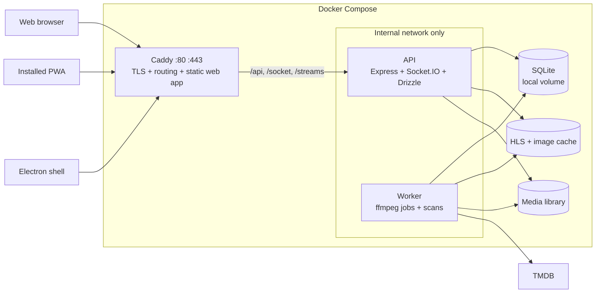

# ShowStream Plan

Last updated: 2026-11-01. Companions: [AUDIT.md](./AUDIT.md) (what is wrong today) and [DECISIONS.md](./DECISIONS.md) (every choice and its status).

ShowStream becomes a self-hosted Jellyfin replacement in this order: modernize and clean up, rebuild on a stable foundation, then add features one at a time.

## 1. Where we start

The foundation decisions are made and the upgrade is committed on `chore/dependency-upgrade`. Next:

1. **Merge the branch to `main`** once you have reviewed it.
2. **Install the remaining AI tooling** ([section 10](#10-ai-tooling)).
3. **Write the `AGENTS.md` files** ([section 11](#11-agentsmd-files)).
4. **Start Phase 1** ([section 12](#12-roadmap)).

| Your question | Answer |
|---|---|
| Decisions to make | [Section 3](#3-decisions) and [DECISIONS.md](./DECISIONS.md) |
| Frontend stack, router and libraries | [Section 4](#4-frontend-stack) |
| Authentication in the API | [Section 5.6](#56-authentication) |
| Problems with the architecture, and the new one | [Section 5](#5-architecture) |
| Problems with the code, and how to fix them | [Section 6](#6-problems-and-fixes) |
| Upgrading to current versions | [Section 7](#7-version-upgrades) |
| Dropping MongoDB, with Drizzle | [Section 8](#8-mongodb-to-sqlite-with-drizzle) |
| Design system, colors, shadcn update | [Section 9](#9-design-system) |
| Web, PWA and Electron | [Section 5.5](#55-one-codebase-three-clients) |
| Skills, plugins and MCPs, including the database MCP | [Section 10](#10-ai-tooling) |
| `AGENTS.md` rules | [Section 11](#11-agentsmd-files) |
| Roadmap | [Section 12](#12-roadmap) |
| Feature list | [Section 13](#13-feature-list) |
| What you were missing | [Section 14](#14-what-was-missing) |

## 2. Status

| Item | State |
|---|---|
| Next.js 16.4.3, React 19.3.1 (latest) | Committed as `7efb290` on `chore/dependency-upgrade`, not merged |
| `pnpm audit --prod` | 0 advisories, down from 79 |
| Ports 5000 and 27017 closed to the host | Committed and tested |
| Real `docker-compose.yml` with Chromium playback | Passes with fake secrets and throwaway data |
| Playwright MCP | Configured in `.mcp.json` and tested; needs approval on first use |
| Other skills and MCPs | Not installed |
| `AGENTS.md` files | Not written |

**Not yet safe for the internet.** The API has no authentication of its own, the default `admin`/`admin` account remains, secrets are baked into the image, and there is no HTTPS. All four are fixed in Phase 1.

## 3. Decisions

All foundation decisions are made:

| Area | Decision |
|---|---|
| Frontend | React SPA built with Vite, replacing Next.js |
| Routing | TanStack Router ([section 4](#4-frontend-stack)) |
| Authentication | Moves entirely into the API ([section 5.6](#56-authentication)) |
| Components | shadcn on Base UI |
| Public entry | Caddy; the API stays on the internal network |
| Database | SQLite with Drizzle ORM, replacing MongoDB |
| Clients | Web, PWA and Electron from one codebase |
| Agent rules | `AGENTS.md` files |

SQLite replaces the earlier Postgres request. The remaining lower-impact choices are in [DECISIONS.md](./DECISIONS.md), and this plan follows their recommendations.

## 4. Frontend stack

### 4.1 Why a Vite SPA

The client is almost entirely client-rendered, and Next's server side was two server actions and the auth proxy, both of which move to the API. A static build means no Node server on the public path, one artifact for web, PWA and Electron, and a bundle that TV and mobile wrappers can use later.

**The costs we accept:** rewriting about 16 route files, owning route guards and image caching ourselves, and losing `next-devtools-mcp` and `next-dev-loop`. Playwright MCP covers most of that checking.

### 4.2 Router: TanStack Router

| | TanStack Router | React Router 8 |
|---|---|---|
| Typed links and params | Built in | Weaker in SPA mode |
| Typed URL search params | First-class, validated with Zod | Manual parsing |
| Data loading | Pairs directly with TanStack Query | Own loaders |
| Route guards | `beforeLoad` with typed context | Loaders |
| Familiarity | Newer, generates `routeTree.gen.ts` | Very widely known |

**TanStack Router wins because a media library is mostly URL state:** search, sort, filters and page all belong in the URL so that views can be shared and survive reload. Typed search params replace the four Zustand stores behind the movie browser, and the same setup carries over to Shows.

### 4.3 Libraries

**Tested** means it is in the 2026-11-01 stack spike. Versions are current latest and get pinned when installed.

| Purpose | Library | Version | Status |
|---|---|---|---|
| UI runtime | `react`, `react-dom` | 19.3.1 | Tested |
| Build | `vite`, `@vitejs/plugin-react` | 8.3.5, 6.1.2 | Tested |
| Routing | `@tanstack/react-router`, `@tanstack/router-plugin` | 1.170.46, 1.168.48 | Tested |
| Server state | `@tanstack/react-query` | 5.105.1 | Tested |
| Styling | `tailwindcss`, `@tailwindcss/vite` | 4.3.3 | Tested |
| Primitives | `@base-ui/react` through shadcn | 1.9.0 | Tested, one component |
| Animation | `tw-animate-css` | 1.4.0 | Planned |
| Icons | `lucide-react` | 1.66.0 | Installed in spike |
| Forms | `react-hook-form`, `@hookform/resolvers` | 7.91.0, 7.0.1 | Installed in spike |
| Validation | `zod`, shared through `packages/contract` | 4.6.7 | Tested |
| Large lists | `@tanstack/react-virtual` | 3.14.25 | Installed in spike |
| Video | `hls.js` | 1.7.4 | In use today |
| Player controls | `media-chrome` | 4.19.4 | Planned; confirm when building S8 |
| Real time | `socket.io-client` | 4.8.4 | In use today |
| Toasts | `sonner` | 2.0.8 | In use today |
| Command menu | `cmdk` | Current | In use today |
| Dates | `date-fns`, `react-day-picker` | 4.4.0, 10.0.2 | In use today, bump pending |
| Local UI state | `zustand` | 5.0.16 | Player preferences only |
| Debounce | `use-debounce` | 10.1.1 | In use today |
| Fonts | `@fontsource-variable/geist` | 5.3.0 | Tested |
| PWA | `vite-plugin-pwa` | 2.0.0 | Tested, service worker generated |
| Desktop | `electron`, `electron-builder` | 45.2.1, 26.18.0 | Planned |
| Unit tests | `vitest`, `@testing-library/react` | 5.0.5, 16.3.3 | Planned |
| API mocks | `msw` | 3.0.3 | Planned |
| Browser tests | `playwright` | 1.64.1 | In use for verification |

**Removed:** `next`, `swr`, `next-themes` (replaced by a small theme provider), and the Next ESLint rules.

**Deliberately not added:** Axios (`packages/api-client` wraps `fetch`), Redux, CSS-in-JS, or a second component library.

### 4.4 Spike results

| Check | Result |
|---|---|
| Install on Node 26 and React 19.3.1 | Pass, no peer dependency warnings |
| Production build with route splitting and PWA | Pass in 223 ms, 580 KB total output |
| Typecheck | Pass |
| Invalid search param value (`sort: 'rating'`) | **Rejected at compile time** |

Not tested: a full app, Base UI beyond a dialog, or browser behavior of auth guards.

### 4.5 App structure

```text
apps/web/src/
├── routes/        File-based routes; thin
├── features/      auth, library, player, settings
├── lib/           query client, socket, theme
└── main.tsx
```

| Route | Screen | Replaces |
|---|---|---|
| `/setup` | First-run owner account | New |
| `/login` | Login | `/login` |
| `/` | Home | `/dashboard` |
| `/movies`, `/movies/$id` | Movie library, detail | `/dashboard/movies` |
| `/shows`, `/shows/$id` | Show library, detail | `/dashboard/shows` |
| `/search` | Search | `/dashboard/search` |
| `/settings` | Settings | `/dashboard/settings` |
| `/watch/$id` | Player | `/video/$id` |

In development, Vite proxies `/api`, `/socket` and `/streams` to the API, so cookies behave as they do behind Caddy.

## 5. Architecture

### 5.1 Problems with the current design

Keeping one public entry point and hiding the API is correct. These problems remain:

| # | Problem | Consequence | Fix |
|---|---|---|---|
| 1 | A closed port is not authentication | Any compromise of Next exposes the whole API | API verifies every request itself |
| 2 | No HTTPS on the public port | PWA service workers will not register; cookies travel in plain text | Caddy terminates TLS |
| 3 | All video flows through Next | Each segment takes an extra hop and an auth call | Caddy routes streams straight to the API |
| 4 | Two backends | Logic and auth are spread across Next and Express | The API is the only backend |
| 5 | ffmpeg runs inside the API process | One bad file takes the API down | Separate worker with a job table |
| 6 | Whole-file conversion before playback | Long waits and doubled storage | On-demand HLS in Phase 4 |
| 7 | Login uses Next server actions | Only web pages can call it | Plain API endpoints |
| 8 | Socket.IO broadcasts to everyone | Events are not scoped to a user | Authenticated sockets and per-user rooms |
| 9 | Client downloads and filters the whole library | Poor scaling with large libraries | Server-side queries with pagination |
| 10 | Types are hand-maintained and unvalidated | API and client can drift; injection risk | Shared Zod contract |

### 5.2 Target architecture



Only ports 80 and 443 are public. Port 80 only redirects to HTTPS. Port 3000 is no longer published.

| Path | Goes to | Notes |
|---|---|---|
| `/api/*` | API | JSON API |
| `/socket/*` | API | Socket.IO, authenticated at the handshake |
| `/streams/*` | API | HLS, session checked by the API; no response compression |
| Everything else | Static web app | SPA fallback to `index.html` |

**HTTPS on a home network:** a public domain gets certificates automatically. A LAN-only install needs Caddy's internal CA trusted on each device, or a Tailscale certificate. Plain HTTP will not support a PWA.

### 5.3 Rules the architecture must keep

1. The API is the only authority for auth and data. Client-side route guards are only for user experience.
2. Nothing outside Caddy is published. Dev-only ports bind to `127.0.0.1` and live in `docker-compose.dev.yml`.
3. The SQLite file sits on a local disk, never NFS or SMB. The media library may be on a NAS.
4. Clients talk to the API only through the shared contract.
5. ffmpeg runs only in the worker.

### 5.4 Repository layout

```text
show-stream/
├── apps/
│   ├── web/            React SPA (web and PWA)
│   ├── api/            Express, Socket.IO, routes and services
│   ├── worker/         ffmpeg jobs, library scans
│   └── desktop/        Electron shell
├── packages/
│   ├── ui/             Tokens, shadcn primitives, patterns
│   ├── contract/       Zod schemas and inferred types (replaces packages/types)
│   ├── api-client/     Typed client used by every app
│   ├── db/             Drizzle schema, migrations, queries
│   ├── eslint-config/
│   └── typescript-config/
├── infra/caddy/        Caddyfile
├── docs/
├── docker-compose.yml
└── docker-compose.dev.yml
```

### 5.5 One codebase, three clients

| Client | How it works | Key work |
|---|---|---|
| Web | Static app served by Caddy | Responsive layouts |
| PWA | Same app plus manifest and service worker | Cache the app shell. **Never cache `/streams`.** Add Media Session controls |
| Electron | Thin shell that asks for a server URL and loads it | `contextIsolation` on, no `nodeIntegration`, navigation limited to the chosen server |

All three use the same origin as the server, so the same cookie session works. Bearer tokens are added when native apps arrive. Offline Electron can bundle `apps/web` later, which is possible because the build is static.

### 5.6 Authentication

The API owns authentication. Next's `proxy.ts`, `lib/login.ts`, `lib/jwt.ts`, the `/authenticate` endpoint, `jsonwebtoken` and `JWT_SECRET` are all removed.

| Topic | Design |
|---|---|
| Sessions | Random 256-bit token; only its SHA-256 hash is stored in `sessions` |
| Cookie | `httpOnly`, `Secure`, `SameSite=Lax`, sent to all routes |
| Lifetime | Sliding 30-day idle expiry, so a film never logs you out |
| Passwords | `bcryptjs`, already in use |
| Default rule | Every route requires auth through shared middleware; public routes are an explicit allowlist |
| Public routes | Login, setup status and first-run setup only |
| Roles | `owner`, `admin`, `user`; scans and user management are admin-only |
| Streams | `/streams` checks the session on each request, with an indexed lookup |
| Sockets | Session checked at the handshake; events sent to per-user rooms |
| CSRF | `SameSite=Lax` plus an `Origin` check on every non-GET request |
| Brute force | `express-rate-limit` on login and setup |
| Behind Caddy | Express `trust proxy` set to the one proxy hop |
| Client | `GET /api/auth/me` fills router context; `beforeLoad` redirects; any 401 returns to login |

| Endpoint | Purpose |
|---|---|
| `GET /api/auth/setup` | Whether first-run setup is needed |
| `POST /api/auth/setup` | Create the owner; rejected once an owner exists |
| `POST /api/auth/login` | Create a session |
| `POST /api/auth/logout` | Delete the session |
| `GET /api/auth/me` | Current user |

`POST /register` and the startup `admin`/`admin` account are deleted, and `GET /scan` becomes an admin-only `POST`.

## 6. Problems and fixes

Numbers 1-40 are the [audit findings](./AUDIT.md#6-findings). 41 onward were found since. "Done" means done on the upgrade branch.

### Security and data

| # | Problem | Fix | Phase |
|---|---|---|---|
| 1 | Next.js/React RCE | Upgraded | Done |
| 2 | API has no authentication | Port closed. Auth required by default ([section 5.6](#56-authentication)) | Partly done; 1 |
| 3 | Default `admin`/`admin` | First-run setup screen creates the owner | 1 |
| 4 | MongoDB `root`/`root` | Port closed; disappears with SQLite | Partly done; 1 |
| 5 | Secrets in the API image | Exclude `.env`; pass with `env_file` | 1 |
| 9 | Operator injection at login | Zod validation; Drizzle parameters | 1 |
| 10 | Sessions expire mid-film | Sliding 30-day sessions | 1 |
| 39 | Cookie not `Secure` | Enable behind HTTPS | 1 |

### Stability

| # | Problem | Fix | Phase |
|---|---|---|---|
| 6 | Bad video crashes the API | ffmpeg moves to the worker, with error handling | 1 |
| 7 | Stuck `in progress` jobs | `failed` state; recover jobs at worker startup | 1 |
| 8 | Malformed URL crashes the API | Validate params; `await` handlers; central error handler | 1 |
| 11 | API errors are discarded | One error shape in the contract | 1 |
| 12 | Unawaited DB checks | Removed with Mongoose | 1 |
| 13 | `MEDIA_FOLDER` half-implemented | One validated config module | 1 |
| 14 | Scan reports false success | Scan is a job with counts and errors | 1 |
| 15 | `lastScanTime` adds rows | Settings table | 1 |
| 16 | No limit on ffmpeg jobs | Queue with a concurrency limit | 1 |
| 36 | Startup relies on crash loops | Health checks and `depends_on` | 1 |
| 37 | Logs unrotated, not on a volume | Structured logs to stdout | 1 |

### Frontend behavior

| # | Problem | Fix | Phase |
|---|---|---|---|
| 17 | Polling the whole library | Socket events invalidate queries | 2 |
| 18 | Fake technical details | Real `ffprobe` data | 4 |
| 19 | Fragile image URLs | `MediaImage` with a fallback | 2 |
| 29 | Date filter format bug | Typed date range | 2 |
| 30 | "Popularity" sorts by vote count | Server-side sort on the correct field | 2 |
| 31 | `.sort()` mutates shared arrays | Sorting moves to the server | 2 |
| 32 | Empty library gives `-Infinity` | Facets come from the API | 2 |
| 33 | hls.js debug on in production | Dev only | 2 |
| 34 | Socket 308 on each request | Direct `/socket` route through Caddy | 1 |

### Tooling and repo

| # | Problem | Fix | Phase |
|---|---|---|---|
| 20 | `pnpm start` fails | Add or remove the task | 1 |
| 21 | `pnpm lint` fails | Fixed | Done |
| 22 | Root ESLint config is broken | Delete `.eslintrc.js` | 1 |
| 23 | No tests or CI | Vitest, Playwright, GitHub Actions | 1 |
| 24 | Malformed Turbo `env` | Two separate entries | 1 |
| 25 | API `dist/` not cached by Turbo | Add `dist/**` to `outputs` | 1 |
| 26 | `--host-name` does nothing | Dockerfile no longer uses it; remove the script flag | 1 |
| 27 | `public/` copied to the wrong path | Goes away with static hosting | 2 |
| 28 | `fluent-ffmpeg` deprecated | Replace with `child_process.spawn` | 1 |
| 35 | No-op schema options | Removed with Mongoose | 1 |
| 38 | README incomplete | Rewrite | 1 |
| 40 | Stale `tailwind.config.ts` reference, empty `.npmrc` | Remove | 1 |

### Found since the audit

| # | Problem | Fix | Phase |
|---|---|---|---|
| 41 | Client container crashed at startup; the old image needs internet at boot | Containers start with `node` | Done |
| 42 | API could not write `media/` | API runs as UID 1000 | Done |
| 43 | MongoDB could not start on a fresh `./data` | Runs as UID 1000; disappears with SQLite | Done |
| 44 | UID 1000 is hardcoded | Make `PUID`/`PGID` configurable and document it | 1 |
| 45 | Compose used to publish ports 5000 and 27017 | Closed; dev file for local Mongo | Done |
| 46 | `--font-sans` points at an undefined `--font-geist-sans`, and Zain loads but no class uses it | One font setup ([section 9.4](#94-typography)). Check the rendered font first | 2 |
| 47 | `PlayButton` is duplicated in two files | One shared pattern | 2 |
| 48 | Status colors bypass tokens | Semantic `success`, `warning`, `info` tokens | 2 |
| 49 | `add-shadcn.sh` pins `canary`; `packages/ui` config references a missing file | [Section 9.6](#96-updating-shadcn) | 2 |
| 50 | No project licence | Choose one before release | 1 |

## 7. Version upgrades

**Already latest on the branch:** Next.js 16.4.3, React 19.3.1, Turbo 2.11.10, Tailwind 4.3.3, Prettier 3.9.10, hls.js 1.7.4, tmdb-ts 2.3.0, Zustand 5.0.16, SWR 2.5.1.

| Package | Now | Target | When | Notes |
|---|---|---|---|---|
| Node image | 22.15 | 26 LTS | 1 | Node 26 has no corepack; Dockerfiles install pnpm directly |
| pnpm | 10.13.1 | 12.16.1 | 1 | Check workspace overrides and build allowlists |
| TypeScript | 5.7.3 and 5.9.3 | 7.0.2 if the stack supports it | 1 | Not tried. Otherwise newest supported. Replace `ts-node` with `tsx` |
| ESLint | 9.39.5 | 10.14.0 | 1 | Check plugin support first |
| dotenv | 16.6.1 | 18 or removed | 1 | Node can load env files itself |
| lucide-react | 0.477.0 | 1.66.0 | 2 | Major jump; check icon renames |
| @hookform/resolvers | 5.9.2 | 7.0.1 | 2 | With the form rebuild |
| react-day-picker | 9.14.0 | 10.0.2 | 2 | With the shadcn update |
| mongoose | 8.24.7 | Removed | 1 | |
| fluent-ffmpeg | 2.1.3 | Removed | 1 | |
| next, swr, next-themes | Current | Removed | 2 | Replaced by the [frontend stack](#4-frontend-stack) |
| jsonwebtoken | 9.0.2 | Removed | 1 | Replaced by API sessions |

Each row group gets its own commit, with typecheck, build, lint and the Chromium flow run afterwards. Anything that cannot move yet is left out and recorded here.

## 8. MongoDB to SQLite with Drizzle

**Stack:** `drizzle-orm`, `drizzle-kit`, and `better-sqlite3` on the SQLite WAL journal. Drizzle has no `node:sqlite` driver.

**Tested on 2026-11-01:** Drizzle with `better-sqlite3` on Node 26 and `node:26-alpine`; a movie and a show sharing a TMDB ID; JSON columns; a second container reading a live WAL database. Not yet tested: `drizzle-kit` migrations and a bind-mounted `./data`. Drizzle is pre-1.0 (0.45.4), so versions are pinned.

### Schema

| Table | Key columns | Replaces or fixes |
|---|---|---|
| `users` | `id`, `username` unique, `password_hash`, `role` | `users` |
| `sessions` | `id`, `user_id`, `expires_at` | Audit finding 10 |
| `media` | `id`, `type`, `tmdb_id`, `title`, `year`, `path`, indexed filter columns, `metadata` JSON | `media`, `movies`, `shows`; unique `(type, tmdb_id)` fixes the ID collision |
| `media_files` | `id`, `media_id`, `path`, codec, resolution and stream data | Phase 4 playback |
| `seasons`, `episodes` | Link to `media` | Phase 6 |
| `jobs` | `id`, `type`, `status`, `payload`, `attempts`, `error` | `transcodes`, in-memory state, findings 6, 7, 16 |
| `watch_progress` | `user_id`, `media_file_id`, `position` | Phase 5 |
| `settings` | `key`, `value` | `metadatas` |

### Steps

1. Create `packages/db` with the schema, the first migration and connection setup (WAL, `busy_timeout`, foreign keys on).
2. Move the 28 model calls behind repository functions in `auth`, `media` and `video`, with tests first where practical.
3. Replace the hand-written types in `packages/types/src/db-types.ts`.
4. Move library sorting and filtering into SQL. FTS5 powers search.
5. Run migrations at API startup.
6. Remove Mongoose, the `mongodb` service, `MONGO_DB_*` variables and `data/` Mongo docs.
7. Add scheduled `VACUUM INTO` backups.

No data migration is needed if no other deployment holds data: `data/` in this repo is empty. A library can be rebuilt by rescanning, except for users.

**SQLite limits accepted:** one writer at a time, which is fine for these short writes. Single host only. Database on local disk only.

## 9. Design system

### 9.1 Direction

Posters and backdrops supply the color, so the interface stays quiet: dark-first, a cool neutral base, and one warm amber accent like a cinema marquee. Light mode is fully supported. The accent is one token, so changing it later is cheap.

### 9.2 Layers

```text
Tokens       colors, type, spacing, radius, motion
   ↓
Primitives   shadcn components in packages/ui/src/components
   ↓
Patterns     product components in packages/ui/src/patterns
   ↓
Screens      thin route files in apps/web
```

**Rules:**

- Screens contain layout and data wiring, not styling decisions.
- Components use semantic tokens, never raw colors like `text-red-500`.
- Primitives stay close to upstream shadcn so they can be updated.
- Every pattern handles loading, empty and error states.
- Everything works by keyboard, which also prepares for TV remotes.

### 9.3 Color tokens

Contrast is checked by script. All pairs pass: text at 4.5:1 or better, foreground on background at 7:1 or better, status colors at 3:1 or better. All values are in the sRGB gamut.

| Token | Dark | Dark hex | Light | Light hex |
|---|---|---|---|---|
| `background` | `oklch(.145 .012 265)` | `#080a0f` | `oklch(.985 .002 265)` | `#f9fafb` |
| `card` | `oklch(.185 .014 265)` | `#101319` | `oklch(1 0 265)` | `#ffffff` |
| `popover` | `oklch(.205 .015 265)` | `#14171e` | `oklch(1 0 265)` | `#ffffff` |
| `muted` | `oklch(.225 .015 265)` | `#181c23` | `oklch(.955 .005 265)` | `#eef0f4` |
| `secondary` | `oklch(.255 .016 265)` | `#1f232b` | `oklch(.945 .005 265)` | `#ebedf0` |
| `border` | `oklch(.32 .016 265)` | `#2f333b` | `oklch(.895 .007 265)` | `#dadce1` |
| `foreground` | `oklch(.97 .004 265)` | `#f4f5f8` | `oklch(.2 .015 265)` | `#13161d` |
| `muted-foreground` | `oklch(.74 .014 265)` | `#a6abb4` | `oklch(.47 .016 265)` | `#565b64` |
| `primary` | `oklch(.8 .145 70)` | `#f9ac46` | `oklch(.5 .115 60)` | `#915006` |
| `primary-foreground` | `oklch(.2 .04 60)` | `#231103` | `oklch(.985 .01 70)` | `#fff9f3` |
| `destructive` | `oklch(.68 .19 25)` | `#f75d59` | `oklch(.52 .19 27)` | `#be2323` |
| `destructive-foreground` | `oklch(.16 .03 25)` | `#180807` | `oklch(.985 .005 27)` | `#fdf9f8` |
| `success` | `oklch(.76 .15 155)` | `#52cd86` | `oklch(.47 .105 155)` | `#196c40` |
| `warning` | `oklch(.84 .15 90)` | `#f0c543` | `oklch(.5 .105 75)` | `#865901` |
| `info` | `oklch(.74 .12 240)` | `#5cb4ef` | `oklch(.48 .115 245)` | `#0e629a` |

Also add an `overlay` token for scrims over posters, replacing `bg-neutral-950/25` and `/75`. `accent` and `input` map to `secondary` and `border`, `ring` maps to `primary`. A rendered preview is reviewed before this is final.

### 9.4 Typography

One family: Geist Sans for UI and Geist Mono for technical data, self-hosted through `@fontsource-variable/geist`. Remove Zain. Text sizes come from the Tailwind scale. Keep the `0.6rem` radius.

### 9.5 Components

**Primitives to keep:** all 16 current components are in use.

**Primitives to add:** badge, skeleton, tabs, sheet, sidebar, separator, scroll-area, slider, progress, switch, checkbox, alert-dialog, table, avatar.

| Pattern | Replaces | Used by |
|---|---|---|
| `AppShell`, `NavSidebar`, `MobileNav` | `dashboard/sidebar.tsx`, layouts | All signed-in screens |
| `PageContainer`, `PageHeader` | `media-page.tsx` | All screens |
| `MediaCard`, `MediaGrid`, `MediaRow` | `media-card.tsx`, `media-card-container.tsx` | Home, Movies, Shows, Search |
| `MediaImage` | Inline image URLs | Everywhere with art |
| `MediaHero` | `movies/[id]/page.tsx` | Movie, Show details |
| `PlayButton`, `StatusBadge` | Two `PlayButton`s, `transcode-status-icon.tsx` | Cards, details |
| `FilterBar`, `FilterPanel`, `SearchInput`, `SortSelect` | `media-browser.tsx` (449 lines) | Any list |
| `RangeFilter`, `DateRangeFilter`, `FacetFilter` | Filter components in `media-browser.tsx` | Any list |
| `VideoPlayer`, `PlayerControls` | `hls-player.tsx` | Player |
| `EmptyState`, `ErrorState`, `LoadingGrid` | New | Every data view |
| `SettingsSection`, `ConfirmDialog`, `DataTable` | New | Settings, Admin |

Logic in `use-movies-browser.tsx` becomes a generic list hook over server queries, which is what lets Shows reuse the Movies screen.

A dev-only `/dev/components` route shows every pattern in both themes.

### 9.6 Updating shadcn

The current setup is `new-york` style on Radix with Tailwind v4. **We are moving to Base UI**, shadcn's current default. This happens in Phase 2, in `packages/ui`, before patterns are built on it.

1. Run `pnpm dlx shadcn@latest info` from `apps/web` and `packages/ui`.
2. Align both `components.json` files. They must share `style`, `iconLibrary` and `baseColor`. Use a Base UI style such as `base-nova`, leave `tailwind.config` empty for Tailwind v4, and set `rsc: false`.
3. Replace `tailwindcss-animate` with `tw-animate-css`.
4. Run `pnpm dlx shadcn@latest migrate cn`.
5. Install the shadcn skill and migrate primitives one at a time. Migrations produce a report and a commit per component; `asChild` becomes `render`.
6. Use `add --diff` on customized components such as `dual-range-slider`.
7. Delete `add-shadcn.sh`, which pins `canary`.

## 10. AI tooling

The desktop docs state plugins are not available in WSL sessions, so everything here is file-based. Each install runs third-party code; review what it writes before committing.

### 10.1 Skills

| Tool | Command | Notes |
|---|---|---|
| Impeccable | `npx impeccable install --providers=claude --scope=project --no-hooks` | Then `npx impeccable telemetry off`. Telemetry is on by default, and its hook runs outside model approval and may download a binary. Pin the version |
| Matt Pocock skills | `npx skills@latest add mattpocock/skills` | Then run `/setup-matt-pocock-skills` with GitHub Issues. Install by one route only |
| shadcn skill | `pnpm dlx skills add shadcn/ui` | Needed for Base UI migration |

**Next.js:** the current client is on the latest release, 16.4.3. With the move to Vite, the Next.js skills and `next-devtools-mcp` are **not** installed, because Phase 2 removes Next.

### 10.2 MCP servers

**Playwright is set up.** `.mcp.json` holds a pinned version, and Chromium is installed in `~/.cache/ms-playwright`. It was tested through the exact configured command, which drove headless Chromium to a local page and returned a page snapshot.

```json
{
  "mcpServers": {
    "playwright": {
      "command": "npx",
      "args": ["-y", "@playwright/mcp@0.0.84", "--headless", "--isolated", "--browser", "chromium"]
    }
  }
}
```

Claude Code asks for approval on first use, and a new session is needed to load it. Artifacts go to `.playwright-mcp/`, which is ignored by git.

These two are added when their phase needs them:

```json
{
  "shadcn": { "command": "npx", "args": ["shadcn@latest", "mcp"] },
  "database": { "type": "http", "url": "http://127.0.0.1:8099/mcp" }
}
```

### 10.3 Database MCP in Docker

Uses DBHub in a dev-only Compose profile, in `docker-compose.dev.yml`:

```yaml
services:
  db-mcp:
    profiles: [dev-tools]
    image: bytebase/dbhub:1.5.0
    command: ["--config=/cfg/dbhub.toml", "--transport=http", "--port=8080"]
    ports:
      - "127.0.0.1:8099:8080"
    volumes:
      - sqlite-data:/data:ro
      - ./infra/dbhub.toml:/cfg/dbhub.toml:ro
```

```toml
[[sources]]
id = "dev"
dsn = "sqlite:///data/app.db"

[[tools]]
name = "execute_sql"
source = "dev"
readonly = true
max_rows = 100
```

**Tested against a live WAL database in a named volume:** DBHub read data; `INSERT`, `UPDATE`, `DROP`, a CTE insert and `PRAGMA writable_schema` were all rejected, with the volume mounted read-only and read-write.

**Rules:** never in the production Compose file, always on `127.0.0.1`, always read-only, dev data only. Schema changes go through Drizzle migrations.

### 10.4 Other plugins and skills

| Tool | Verdict | Why |
|---|---|---|
| Playwright MCP | **Done** | Agents can check the real UI |
| `docker-skills` (Docker, Inc.) | Later, if Docker work repeats | Plugin install is unavailable in WSL |
| `ffmpeg-llm` | Skip | Community plugin with privileged reach; Phase 4 needs careful review anyway |
| Other Docker and test generator plugins | Skip | Low benefit over Playwright and normal review |
| Built-in `code-review`, `security-review`, `run` | Use | Already available |

Worth adding as project skills once patterns settle: `add-screen`, `add-api-route`, `add-migration`, each encoding this repo's steps.

## 11. AGENTS.md files

Claude Code reads `AGENTS.md` natively as long as no `CLAUDE.md` exists, and nested files load when a file in that folder is read. Confirm with `/context` in the desktop app. Keep each file short: rules an agent would otherwise get wrong.

| File | Contents |
|---|---|
| `AGENTS.md` | What ShowStream is, layout, commands, the rules in [section 5.3](#53-rules-the-architecture-must-keep), definition of done, links to `docs/` |
| `apps/AGENTS.md` | What each app owns; apps never import from each other |
| `apps/web/AGENTS.md` | Screens stay thin, use patterns before building new UI, API access only through `api-client`, no raw colors, verify UI in a browser |
| `apps/api/AGENTS.md` | Every route validates with the contract and requires auth unless marked public, one error shape, no ffmpeg here |
| `apps/worker/AGENTS.md` | Jobs must be retryable and record failures, ffmpeg only through the wrapper, recover on startup |
| `apps/desktop/AGENTS.md` | Thin shell, security settings are not to be loosened, no product logic |
| `packages/AGENTS.md` | Packages never import from apps; changes to shared packages need a check of their consumers |
| `packages/ui/AGENTS.md` | The layers and rules from [section 9.2](#92-layers), how to add shadcn components |
| `packages/db/AGENTS.md` | Schema changes through migrations only, never edit an applied migration |
| `packages/contract/AGENTS.md` | Schemas are the source of truth; breaking changes need a version note |
| `docs/AGENTS.md` | What each document is for, keep `PLAN.md` and `DECISIONS.md` current, record decisions rather than rewriting history |

**Definition of done** for the root file: typecheck, lint, tests and build pass; UI changes verified in a browser; no secrets committed; docs updated.

## 12. Roadmap

Each phase ends with a working app.

### Phase 0: Baseline (now)

- [x] Foundation decisions
- [x] Upgrade committed
- [x] Playwright MCP
- [ ] Merge to `main`
- [ ] Install Impeccable, Matt Pocock skills and the shadcn skill, then review what they add
- [ ] Add the shadcn MCP
- [ ] Write `AGENTS.md` files

**Done when:** `main` holds the upgraded baseline, MCPs connect, and `/context` shows the rules.

### Phase 1: Stable foundation

1. Toolchain upgrades, then CI with typecheck, lint, build and audit.
2. Repository restructure from [section 5.4](#54-repository-layout).
3. Vitest and Playwright around today's behavior, including every crash from the audit.
4. Shared contract, typed client, config validation, one error shape.
5. SQLite and Drizzle.
6. Authentication in the API ([section 5.6](#56-authentication)), first-run setup, authenticated sockets.
7. Worker with the job table and ffmpeg wrapper.
8. Caddy, HTTPS, health checks, secrets through `env_file`.

The Next client stays running behind Caddy until Phase 2 replaces it. It only receives the changes it needs: login through the API and removal of `proxy.ts`. No new work goes into it.

**Done when:** the audit crash cases have passing tests, only 80 and 443 are public, and a fresh `docker compose up` reaches a setup screen. **This is the earliest the app may go on the internet.**

### Phase 2: Design system and frontend rebuild

1. Create `apps/web` with the [frontend stack](#4-frontend-stack), and get login working end to end.
2. Add tokens and fonts, then a rendered theme preview for review.
3. Update shadcn and migrate primitives to Base UI.
4. Build the patterns and `/dev/components`.
5. Add the API image cache and server-side library queries.
6. Rebuild Movies, Movie detail, Player and Settings on the patterns.
7. Switch Caddy to serve `apps/web`.
8. Delete `apps/next-client`, `next`, `swr` and the Next ESLint rules.

**Done when:** today's features work on the new patterns in both themes, at phone and desktop widths, and no Next.js code remains.

### Phase 3: PWA and Electron

Manifest, service worker, install flow, Media Session. Electron shell with server URL setup, packaged for Windows and Linux first.

**Done when:** the app installs as a PWA over HTTPS, and Electron logs in and plays a film.

### Phase 4: Real playback

The stage that decides whether this can replace Jellyfin: `ffprobe` data, client capability detection, direct play, remux or transcode per client, on-demand HLS, `.mkv` support, hardware acceleration, cache eviction.

**Done when:** a typical `.mkv` H.265 file starts within seconds and seeks freely.

### Phase 5: A real media server

Audio and subtitle tracks, resume, Home, Search, users and roles, admin, file watching, metadata correction.

### Phase 6: TV shows

Seasons, episodes, next-episode flow, reusing the Movies patterns.

### Phase 7: Reach

Public API docs, mobile and TV wrappers, casting, SyncPlay.

## 13. Feature list

Built top to bottom. Each row is one vertical slice, tested end to end. Sizes are relative.

| ID | Feature | Phase | Size | Needs |
|---|---|---:|---:|---|
| S1 | First-run setup creates the owner account | 1 | M | Auth |
| S2 | Log in, log out, sessions survive long films | 1 | M | Auth |
| S3 | Admin triggers a scan and sees the result | 1 | M | Worker |
| S4 | Failed videos show an error and can be retried | 1 | S | Worker |
| S5 | App shell with responsive navigation | 2 | M | Design system |
| S6 | Movie library with server-side search, sort, filter, pagination | 2 | L | S5 |
| S7 | Movie detail page | 2 | M | S6 |
| S8 | Player page with keyboard controls | 2 | M | S7 |
| S9 | Settings: theme and account | 2 | S | S5 |
| S10 | Install as a PWA | 3 | M | HTTPS |
| S11 | Desktop app connects to a server | 3 | M | S2 |
| S12 | Real codec and resolution info | 4 | M | S3 |
| S13 | Direct play when the client supports the file | 4 | M | S12 |
| S14 | `.mkv` and other containers | 4 | M | S12 |
| S15 | Instant start with on-demand transcoding and seeking | 4 | L | S13 |
| S16 | Quality selection and adaptive bitrate | 4 | L | S15 |
| S17 | Hardware acceleration | 4 | M | S15 |
| S18 | HLS cache limits and eviction | 4 | S | S15 |
| S19 | Audio track selection | 5 | M | S15 |
| S20 | Subtitles: embedded, external, burn-in | 5 | L | S15 |
| S21 | Watch progress and resume | 5 | M | S8 |
| S22 | Home with Continue Watching and Recently Added | 5 | M | S21 |
| S23 | Global search | 5 | M | S6 |
| S24 | Multiple users, roles, invites | 5 | M | S2 |
| S25 | Admin dashboard: jobs, library, users, storage | 5 | L | S24 |
| S26 | Automatic library watching | 5 | M | S3 |
| S27 | Fix a wrong metadata match | 5 | M | S7 |
| S28 | TV library and folder scanning | 6 | L | S6 |
| S29 | Season and episode pages | 6 | M | S28 |
| S30 | Next-episode autoplay | 6 | S | S29, S21 |
| S31 | Documented public API with bearer tokens | 7 | M | Contract |
| S32 | Mobile and TV apps from the static bundle | 7 | L | S31 |
| S33 | Offline downloads in desktop and PWA | 7 | L | S15 |
| S34 | Casting | 7 | L | S15 |
| S35 | SyncPlay | 7 | L | S21 |

## 14. What was missing

Added to your list, each recorded in [DECISIONS.md](./DECISIONS.md):

| Gap | Handled in |
|---|---|
| Test stack and CI | Phase 1 |
| Backups for SQLite | Section 8 |
| Automated dependency updates | Phase 1, with CI |
| Config validation and structured logs | Phase 1 |
| Trusted HTTPS for LAN-only installs | Section 5.2 |
| Shared API contract and typed client | Section 5.4 |
| Background job handling without Redis | Sections 5 and 8 |
| Image caching | Phase 2 |
| Keyboard and TV navigation | Section 9.2 |
| `PUID`/`PGID` for other hosts | Section 6, item 44 |
| Release flow, image registry, changelog | Before first public release |
| Project licence | Phase 1 |

## 15. Risks and unknowns

| Risk | Plan |
|---|---|
| TypeScript 7 or ESLint 10 may not fit the stack | Try in Phase 1; stay on the newest supported version if not |
| Phase 4 is much larger than it looks | Direct play first, so value arrives early |
| Plugin, skill and MCP behavior in WSL desktop sessions | Verified at install; documentation does not confirm project skills in the Code tab |
| Real TMDB responses have never been verified | Test with a real token in Phase 1 |
| Drizzle is pre-1.0 | Pin versions; keep queries behind `packages/db` |
| Only Chromium is tested | Add Firefox and WebKit in Playwright; test real Safari in Phase 3 |
| Caddy, Electron and full-app PWA behavior are planned, not prototyped | Each gets a test in its phase |
| Moving auth while the Next client still runs | Keep Next changes minimal, and cover login with a browser test first |
| `media-chrome` may not suit the player | Confirm in S8; fall back to custom controls on `hls.js` |
