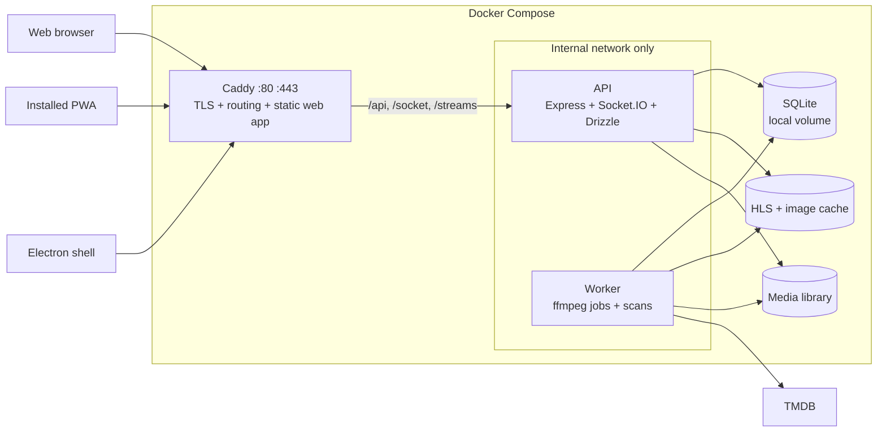

# ShowStream Plan

Last updated: 2026-11-02. Companions: the [repository audit](./audits/2026-10-31-repository-audit.md), [accepted decisions](./adr/README.md) and [open decisions](./open-decisions.md).

ShowStream becomes a self-hosted Jellyfin replacement in this order: modernize and clean up, rebuild on a stable foundation, then add features one at a time.

## 1. Where we start

The foundation decisions are made, and the toolchain, CI, contributor setup, repository restructure, tests, shared contract, SQLite move, API authentication and the worker are done. Next:

1. **Finish Phase 1 with the rest of item 9: health checks, secrets, logs and `PUID`** ([section 12](#12-roadmap)) using the engineering skills ([section 10.5](#105-how-we-develop)). Caddy and HTTPS are done.

| Your question | Answer |
|---|---|
| Decisions to make | [Section 3](#3-decisions) and [open decisions](./open-decisions.md) |
| Frontend stack, router and libraries | [Section 4](#4-frontend-stack) |
| Authentication in the API | [Section 5.6](#56-authentication) |
| The worker and its jobs | [Section 5.7](#57-worker-and-jobs) |
| Problems with the architecture, and the new one | [Section 5](#5-architecture) |
| Problems with the code, and how to fix them | [Section 6](#6-problems-and-fixes) |
| Upgrading to current versions | [Section 7](#7-version-upgrades) |
| Dropping MongoDB, with Drizzle | [Section 8](#8-mongodb-to-sqlite-with-drizzle) |
| Design system, colors, shadcn update | [Section 9](#9-design-system) |
| Web, PWA and Electron | [Section 5.5](#55-one-codebase-three-clients) |
| Skills, plugins and MCPs, including the database MCP | [Section 10](#10-ai-tooling) |
| `AGENTS.md` rules | [Section 11](#11-agentsmd-files) |
| Roadmap | [Section 12](#12-roadmap) |
| Feature list | [Section 13](#13-feature-list) |
| What you were missing | [Section 14](#14-what-was-missing) |

## 2. Status

| Item | State |
|---|---|
| Next.js 16.4.3, React 19.3.1 (latest) | Merged to `main` (`7efb290`) |
| Node 26, pnpm 12, TypeScript 7, ESLint 10 | Done; CI and both images tested |
| Setup from a clone | `scripts/setup.sh` tested in a clean container; `pnpm dev` works |
| Repository layout | `apps/api`, `apps/worker`, `packages/contract`, `packages/api-client` and `packages/db` in place; later folders arrive with their steps |
| Required CI check on `main` | Done, and includes the API tests |
| API and browser tests | Done. No `it.fails` marker remains. The browser job only reports |
| Shared contract, typed client, config validation, one error shape | Done. Every route is an endpoint in `packages/contract`, and `packages/api-client` is proven against the real API |
| SQLite and Drizzle | Done. `packages/db` owns the schema and queries, and migrations run at API startup. `pnpm dev` and `pnpm test` need no Docker |
| Authentication | Done. The API owns sessions and first-run setup, every route needs a session unless the contract marks it public, and sockets are authenticated with per-user rooms |
| Worker | Done. `apps/worker` runs transcodes, library scans and daily backups from a job queue in SQLite, with recovery, retry and failure reasons. An admin starts a scan and reads its result in Settings. A real TMDB token has not been tried ([section 15](#15-risks-and-unknowns)) |
| Caddy and HTTPS | Done. Caddy is the only published service, `TLS_MODE` selects `internal`, `public` or `tailscale`, and the browser tests run through it over HTTPS. Only `internal` has been run: the other two pass `caddy validate`, and the maintainer must try them ([section 15](#15-risks-and-unknowns)) |
| `pnpm audit --prod` | 0 advisories, down from 79 |
| Port 5000 closed to the host | Committed and tested |
| Real `docker-compose.yml` with Chromium playback | Passes with fake secrets and throwaway data. A clean clone reaches `/setup` over HTTPS with no prior step |
| Playwright MCP | Configured in `.mcp.json` and tested; needs approval on first use |
| Impeccable, Matt Pocock and shadcn skills, shadcn MCP | Installed |
| Database MCP | Done. DBHub runs read-only in the `dev-tools` Compose profile |
| `AGENTS.md` files | Root, `docs/`, `apps/`, `apps/api`, `apps/worker`, `apps/e2e`, `packages/`, `packages/contract`, `packages/api-client` and `packages/db` written; the rest arrive with their apps and packages |

**Not yet safe for the internet.** Secrets are baked into the image. The rest of item 9 fixes that.

## 3. Decisions

All foundation decisions are made:

| Area | Decision |
|---|---|
| Frontend | React SPA built with Vite, replacing Next.js |
| Routing | TanStack Router ([section 4](#4-frontend-stack)) |
| Authentication | Moves entirely into the API ([section 5.6](#56-authentication)) |
| Components | shadcn on Base UI |
| Public entry | Caddy; the API stays on the internal network |
| Database | SQLite with Drizzle ORM, replacing MongoDB |
| Clients | Web, PWA and Electron from one codebase |
| Agent rules | `AGENTS.md` files |

SQLite replaces the earlier Postgres request. Each one has an [ADR](./adr/README.md). The remaining lower-impact choices are in [open-decisions.md](./open-decisions.md), and this plan follows their recommendations.

## 4. Frontend stack

### 4.1 Why a Vite SPA

The client is almost entirely client-rendered, and Next's server side was two server actions and the auth proxy, both of which move to the API. A static build means no Node server on the public path, one artifact for web, PWA and Electron, and a bundle that TV and mobile wrappers can use later.

**The costs we accept:** rewriting about 16 route files, owning route guards and image caching ourselves, and losing `next-devtools-mcp` and `next-dev-loop`. Playwright MCP covers most of that checking.

### 4.2 Router: TanStack Router

| | TanStack Router | React Router 8 |
|---|---|---|
| Typed links and params | Built in | Weaker in SPA mode |
| Typed URL search params | First-class, validated with Zod | Manual parsing |
| Data loading | Pairs directly with TanStack Query | Own loaders |
| Route guards | `beforeLoad` with typed context | Loaders |
| Familiarity | Newer, generates `routeTree.gen.ts` | Very widely known |

**TanStack Router wins because a media library is mostly URL state:** search, sort, filters and page all belong in the URL so that views can be shared and survive reload. Typed search params replace the four Zustand stores behind the movie browser, and the same setup carries over to Shows.

### 4.3 Libraries

**Tested** means it is in the 2026-11-01 stack spike. Versions are current latest and get pinned when installed.

| Purpose | Library | Version | Status |
|---|---|---|---|
| UI runtime | `react`, `react-dom` | 19.3.1 | Tested |
| Build | `vite`, `@vitejs/plugin-react` | 8.3.5, 6.1.2 | Tested |
| Routing | `@tanstack/react-router`, `@tanstack/router-plugin` | 1.170.46, 1.168.48 | Tested |
| Server state | `@tanstack/react-query` | 5.105.1 | Tested |
| Styling | `tailwindcss`, `@tailwindcss/vite` | 4.3.3 | Tested |
| Primitives | `@base-ui/react` through shadcn | 1.9.0 | Tested, one component |
| Animation | `tw-animate-css` | 1.4.0 | Planned |
| Icons | `lucide-react` | 1.66.0 | Installed in spike |
| Forms | `react-hook-form`, `@hookform/resolvers` | 7.91.0, 7.0.1 | Installed in spike |
| Validation | `zod`, shared through `packages/contract` | 4.6.7 | Tested |
| Large lists | `@tanstack/react-virtual` | 3.14.25 | Installed in spike |
| Video | `hls.js` | 1.7.4 | In use today |
| Player controls | `media-chrome` | 4.19.4 | Planned; confirm when building S8 |
| Real time | `socket.io-client` | 4.8.4 | In use today |
| Toasts | `sonner` | 2.0.8 | In use today |
| Command menu | `cmdk` | Current | In use today |
| Dates | `date-fns`, `react-day-picker` | 4.4.0, 10.0.2 | In use today, bump pending |
| Local UI state | `zustand` | 5.0.16 | Player preferences only |
| Debounce | `use-debounce` | 10.1.1 | In use today |
| Fonts | `@fontsource-variable/geist` | 5.3.0 | Tested |
| PWA | `vite-plugin-pwa` | 2.0.0 | Tested, service worker generated |
| Desktop | `electron`, `electron-builder` | 45.2.1, 26.18.0 | Planned |
| Unit tests | `vitest` | 5.0.5 | In use for the API |
| Component tests | `@testing-library/react` | 16.3.3 | Planned |
| API mocks | `msw` | 3.0.3 | Planned |
| Browser tests | `@playwright/test` | 1.64.1 | In use in `apps/e2e` |

**Removed:** `next`, `swr`, `next-themes` (replaced by a small theme provider), and the Next ESLint rules.

**Deliberately not added:** Axios (`packages/api-client` wraps `fetch`), Redux, CSS-in-JS, or a second component library.

### 4.4 Spike results

| Check | Result |
|---|---|
| Install on Node 26 and React 19.3.1 | Pass, no peer dependency warnings |
| Production build with route splitting and PWA | Pass in 223 ms, 580 KB total output |
| Typecheck | Pass |
| Invalid search param value (`sort: 'rating'`) | **Rejected at compile time** |

Not tested: a full app, Base UI beyond a dialog, or browser behavior of auth guards.

### 4.5 App structure

```text
apps/web/src/
├── routes/        File-based routes; thin
├── features/      auth, library, player, settings
├── lib/           query client, socket, theme
└── main.tsx
```

| Route | Screen | Replaces |
|---|---|---|
| `/setup` | First-run owner account | New |
| `/login` | Login | `/login` |
| `/` | Home | `/dashboard` |
| `/movies`, `/movies/$id` | Movie library, detail | `/dashboard/movies` |
| `/shows`, `/shows/$id` | Show library, detail | `/dashboard/shows` |
| `/search` | Search | `/dashboard/search` |
| `/settings` | Settings | `/dashboard/settings` |
| `/watch/$id` | Player | `/video/$id` |

In development, Vite proxies `/api`, `/socket` and `/streams` to the API, so cookies behave as they do behind Caddy.

## 5. Architecture

### 5.1 Problems with the current design

Keeping one public entry point and hiding the API is correct. These problems remain:

| # | Problem | Consequence | Fix |
|---|---|---|---|
| 1 | A closed port is not authentication | Any compromise of Next exposes the whole API | API verifies every request itself |
| 2 | No HTTPS on the public port | PWA service workers will not register; cookies travel in plain text | Caddy terminates TLS |
| 3 | All video flows through Next | Each segment takes an extra hop and an auth call | Caddy routes streams straight to the API |
| 4 | Two backends | Logic and auth are spread across Next and Express | The API is the only backend |
| 5 | ffmpeg ran inside the API process | One bad file took the API down | Done: a separate worker with a job table ([section 5.7](#57-worker-and-jobs)) |
| 6 | Whole-file conversion before playback | Long waits and doubled storage | On-demand HLS in Phase 4 |
| 7 | Login uses Next server actions | Only web pages can call it | Plain API endpoints |
| 8 | Socket.IO broadcasts to everyone | Events are not scoped to a user | Authenticated sockets and per-user rooms |
| 9 | Client downloads and filters the whole library | Poor scaling with large libraries | Server-side queries with pagination |
| 10 | Types are hand-maintained and unvalidated | API and client can drift; injection risk | Shared Zod contract |

### 5.2 Target architecture



Only ports 80 and 443 are public, over TCP. Port 80 only redirects to HTTPS. HTTP/3 is off, because it needs UDP 443. Port 3000 is no longer published. `infra/caddy/Caddyfile` holds this, and a test in the required check fails on any other published port.

| Path | Goes to | Notes |
|---|---|---|
| `/api/*` | API | JSON API, with the prefix removed, because the API serves its routes at the root |
| `/socket/*` | API | Socket.IO, authenticated at the handshake |
| `/streams/*` | API | HLS, session checked by the API; no response compression. The Next client still asks for `/api/streams/*`, which is not compressed either |
| Everything else | Static web app | SPA fallback to `index.html`. The Next client until Phase 2 item 7 |

A built Next client has no rewrites, so nothing it serves can reach the API. They exist only under `pnpm dev`, which has no Caddy.

**HTTPS on a home network:** `TLS_MODE` selects the mode, and hosts never edit the Caddyfile. `internal`, the default, needs Caddy's CA trusted on each device. `public` gets certificates automatically for a public domain. `tailscale` fetches a certificate from `tailscaled`, whose socket comes from `docker-compose.tailscale.yml`. Plain HTTP will not support a PWA. See the [self-hosting guide](./guides/self-hosting.md).

### 5.3 Rules the architecture must keep

1. The API is the only authority for auth and data. Client-side route guards are only for user experience.
2. Nothing outside Caddy is published. Dev-only ports bind to `127.0.0.1` and live in `docker-compose.dev.yml`.
3. The SQLite file sits on a local disk, never NFS or SMB. The media library may be on a NAS.
4. Clients talk to the API only through the shared contract.
5. ffmpeg runs only in the worker.

### 5.4 Repository layout

```text
show-stream/
├── apps/
│   ├── web/            React SPA (web and PWA)
│   ├── api/            Express, Socket.IO, routes and services
│   ├── worker/         ffmpeg jobs, library scans
│   ├── desktop/        Electron shell
│   └── e2e/            Browser tests
├── packages/
│   ├── ui/             Tokens, shadcn primitives, patterns
│   ├── contract/       Zod schemas and inferred types
│   ├── api-client/     Typed client used by every app
│   ├── db/             Drizzle schema, migrations, queries
│   ├── eslint-config/
│   └── typescript-config/
├── infra/caddy/        Caddyfile
├── docs/
├── docker-compose.yml
└── docker-compose.dev.yml
```

### 5.5 One codebase, three clients

| Client | How it works | Key work |
|---|---|---|
| Web | Static app served by Caddy | Responsive layouts |
| PWA | Same app plus manifest and service worker | Cache the app shell. **Never cache `/streams`.** Add Media Session controls |
| Electron | Thin shell that asks for a server URL and loads it | `contextIsolation` on, no `nodeIntegration`, navigation limited to the chosen server |

All three use the same origin as the server, so the same cookie session works. Bearer tokens are added when native apps arrive. Offline Electron can bundle `apps/web` later, which is possible because the build is static.

### 5.6 Authentication

The API owns authentication. Next's `proxy.ts`, `lib/login.ts`, `lib/jwt.ts`, the `/authenticate` endpoint, `jsonwebtoken` and `JWT_SECRET` are all removed.

| Topic | Design |
|---|---|
| Sessions | Random 256-bit token; only its SHA-256 hash is stored in `sessions` |
| Cookie | `session`: `httpOnly`, `Secure`, `SameSite=Lax`, sent to all routes. `SESSION_COOKIE_SECURE=false` turns `Secure` off for plain HTTP, which only `pnpm dev` sets |
| HSTS | Not sent, because a browser that has seen it offers no way past an untrusted certificate, which an internal CA install needs |
| Lifetime | Sliding 30-day idle expiry, so a film never logs you out. Extended at most once an hour, so that segments cost no writes |
| Passwords | `bcryptjs`, already in use |
| Default rule | Every route requires auth through shared middleware; public routes are an explicit allowlist |
| Public routes | Login, setup status and first-run setup only. A contract endpoint is protected unless it says `access: 'public'`, and the route helper enforces this |
| Roles | `owner`, `admin`, `user`; scans and user management are admin-only |
| Streams | `/streams` checks the session on each request, with an indexed lookup |
| Sockets | Session checked at the handshake; events sent to per-user rooms |
| CSRF | `SameSite=Lax` plus an `Origin` check on every non-GET request and the socket handshake. The `Origin` host must match the host the proxy was asked for |
| Brute force | `express-rate-limit` on login and setup: 10 failures per address in 15 minutes |
| Behind Caddy | Express `trust proxy` set to the one proxy hop |
| Client | `GET /api/auth/me` fills router context; `beforeLoad` redirects; any 401 returns to login |

The API serves these at `/auth/*`, and clients reach them as `/api/auth/*`, because Caddy removes the prefix.

| Endpoint | Purpose |
|---|---|
| `GET /api/auth/setup` | Whether first-run setup is needed |
| `POST /api/auth/setup` | Create the owner; rejected once an owner exists |
| `POST /api/auth/login` | Create a session |
| `POST /api/auth/logout` | Delete the session |
| `GET /api/auth/me` | Current user |

`POST /register` and the startup `admin`/`admin` account are deleted. An admin-only `POST /scan` queues a scan, and an admin-only `GET /scan` reads the latest one.

### 5.7 Worker and jobs

`apps/worker` is a separate process and image that takes jobs from the `jobs` table. It publishes no ports, does not run migrations, and waits at startup until the API has applied them. SQLite is the only link between the two ([ADR 0009](./adr/0009-job-queue-in-sqlite-with-a-separate-worker.md)).

| Topic | Design |
|---|---|
| Job states | `queued`, `running`, `done`, `failed`. `error` keeps the reason and `attempts` counts runs |
| API status | Derived: no job is `not ready`, queued or running is `in progress`, done is `ready`, failed is `failed` |
| Claiming | One `UPDATE` statement, so that no job runs twice |
| Concurrency | `JOB_CONCURRENCY`, default 1 |
| ffmpeg | `runFfmpeg`: `spawn` with an argument array and no shell. It keeps the tail of stderr, and the worker removes media paths from the reason |
| Partial output | A run writes to `cache/<id>.partial-<attempt>` and renames it to `cache/<id>` only on success. The API also ignores a cached playlist with no `#EXT-X-ENDLIST`, which an older version may have left |
| Failure | A failed run is `failed` and is not retried automatically, because a corrupt file fails the same way every time |
| Recovery | At startup, `running` jobs are from a dead process. They requeue, and fail after 3 attempts. A clean shutdown stops ffmpeg, requeues the job and does not count the run |
| Retry | `POST /transcode/retry/:id` requeues a failed job and looks for its video again. `GET /transcode/request/:id` never requeues one, so that loading a page does not repeat a failure |
| Requesting users | The job's payload keeps everyone who asked, including anyone who asks while it runs |
| Notifications | The API polls every 500 ms for finished jobs not yet announced, sends `transcode:ready` or `transcode:failed` to those users' rooms, and marks them announced |
| Jobs with no title | `scan` and `backup` have a NULL `media_id`. A partial unique index allows one active job of each, and queueing one deletes the type's older, finished row |
| Scans | `POST /scan` queues a job and answers 202, or 409 if one is active. The worker saves each title as it goes, and keeps counts and up to 20 problems in the job's payload. `GET /scan` reads them |
| Scan outcome | The job fails if there is no TMDB token, or if folders were found and none were identified. Partial success is `done`, with its failures listed. Nothing retries a scan, because an admin can start another |
| Backups | The worker checks every minute. When a new UTC day has no backup, one transaction queues a `backup` job and stores the day in `settings`, so that a restart cannot repeat it, and recovery looks after the job. A missed day is taken at the next start. A failed backup waits for the next day |
| Backup files | `VACUUM INTO` writes `show-stream-YYYY-MM-DD.db.partial` in `BACKUP_FOLDER`, which is renamed when complete. A day with a file keeps it, so that a restore cannot be overwritten by the older database. The last 7 stay |

There is one worker per database. Claims are safe with two, but a worker starting up treats every `running` job as dead, so a second worker requeues what the first is running.

## 6. Problems and fixes

Numbers 1-40 are the [audit findings](./audits/2026-10-31-repository-audit.md#6-findings). 41 onward were found since. "Done" means done on the upgrade branch.

### Security and data

| # | Problem | Fix | Phase |
|---|---|---|---|
| 1 | Next.js/React RCE | Upgraded | Done |
| 2 | API has no authentication | Port closed. Auth required by default ([section 5.6](#56-authentication)) | Done |
| 3 | Default `admin`/`admin` | First-run setup screen creates the owner, and a migration deletes the old account | Done |
| 4 | MongoDB `root`/`root` | Gone with SQLite, which has no password or server | Done |
| 5 | Secrets in the API image | Exclude `.env`; pass with `env_file` | 1 |
| 9 | Operator injection at login | Zod validation in the contract, and Drizzle parameters | Done |
| 10 | Sessions expire mid-film | Sliding 30-day sessions | Done |
| 39 | Cookie not `Secure` | `Secure` by default, and only `pnpm dev` turns it off | Done |

### Stability

| # | Problem | Fix | Phase |
|---|---|---|---|
| 6 | Bad video crashes the API | ffmpeg moved to the worker, and the job fails with a reason | Done |
| 7 | Stuck `in progress` jobs | `failed` state; jobs recover at worker startup | Done |
| 8 | Malformed URL crashes the API | Validate params; `await` handlers; central error handler | Done |
| 11 | API errors are discarded | One error shape in the contract | Done |
| 12 | Unawaited DB checks | Removed with Mongoose | Done |
| 13 | `MEDIA_FOLDER` half-implemented | One validated config module | Done |
| 14 | Scan reports false success | Scan is a job with counts and errors | Done |
| 15 | `lastScanTime` adds rows | Gone. A scan's job keeps its time | Done |
| 16 | No limit on ffmpeg jobs | Queue with a concurrency limit | Done |
| 36 | Startup relies on crash loops | Health checks and `depends_on` | 1 |
| 37 | Logs unrotated, not on a volume | Structured logs to stdout | 1 |

### Frontend behavior

| # | Problem | Fix | Phase |
|---|---|---|---|
| 17 | Polling the whole library | Socket events invalidate queries | 2 |
| 18 | Fake technical details | Real `ffprobe` data | 4 |
| 19 | Fragile image URLs | `MediaImage` with a fallback | 2 |
| 29 | Date filter format bug | Typed date range | 2 |
| 30 | "Popularity" sorts by vote count | Server-side sort on the correct field | 2 |
| 31 | `.sort()` mutates shared arrays | Sorting moves to the server | 2 |
| 32 | Empty library gives `-Infinity` | Facets come from the API | 2 |
| 33 | hls.js debug on in production | Dev only | 2 |
| 34 | Socket 308 on each request | Direct `/socket` route through Caddy. `pnpm dev` keeps the 308 | Done |

### Tooling and repo

| # | Problem | Fix | Phase |
|---|---|---|---|
| 20 | `pnpm start` fails | Root task removed. Only the API has a `start` script | Done |
| 21 | `pnpm lint` fails | Fixed | Done |
| 22 | Root ESLint config is broken | Deleted `.eslintrc.js` | Done |
| 23 | No tests or CI | CI, Vitest and Playwright in place | Done |
| 24 | Malformed Turbo `env` | Two separate entries | Done |
| 25 | API `dist/` not cached by Turbo | Added `dist/**` to `outputs` | Done |
| 26 | `--host-name` does nothing | Removed with the Next `start` script | Done |
| 27 | `public/` copied to the wrong path | Goes away with static hosting | 2 |
| 28 | `fluent-ffmpeg` deprecated | Replaced with `child_process.spawn` | Done |
| 35 | No-op schema options | Removed with Mongoose | Done |
| 38 | README incomplete | Rewritten, with `CONTRIBUTING.md` and a setup script | Done |
| 40 | Stale `tailwind.config.ts` reference, empty `.npmrc` | Removed. The `packages/ui` config reference stays until finding 49 | Done |

### Found since the audit

| # | Problem | Fix | Phase |
|---|---|---|---|
| 41 | Client container crashed at startup; the old image needs internet at boot | Containers start with `node` | Done |
| 42 | API could not write `media/` | API runs as UID 1000 | Done |
| 43 | MongoDB could not start on a fresh `./data` | Gone with the MongoDB container. The image gives `/data` to UID 1000 | Done |
| 44 | UID 1000 is hardcoded | Make `PUID`/`PGID` configurable and document it | 1 |
| 45 | Compose used to publish ports 5000 and 27017 | Closed; dev-only ports live in the dev file | Done |
| 46 | `--font-sans` points at an undefined `--font-geist-sans`, and Zain loads but no class uses it | One font setup ([section 9.4](#94-typography)). Check the rendered font first | 2 |
| 47 | `PlayButton` is duplicated in two files | One shared pattern | 2 |
| 48 | Status colors bypass tokens | Semantic `success`, `warning`, `info` tokens | 2 |
| 49 | `add-shadcn.sh` pins `canary`; `packages/ui` config references a missing file | [Section 9.6](#96-updating-shadcn) | 2 |
| 50 | No project licence | Apache-2.0, with a `NOTICE` that requires attribution | Done |
| 51 | Shared ESLint config does not ignore `.next`, so linting after a build scanned generated output (about 26,000 warnings in the ESLint 10 trial) | Add `.next/**` to the ignores | Done |
| 52 | Next forwards a client's own `X-Forwarded-For`, so a client that sets it escapes the login rate limit | Caddy replaces the header, and a browser test proves that the spoof reaches the limit | Done |

## 7. Version upgrades

**Verified 2026-11-01 on the moved versions:** typecheck, lint and build pass in CI. Both images build on `node:26.13-alpine` and the Chromium flow passes: login, library, detail, socket, HLS playback and seek, with fake secrets and a test clip.

| Package | From | Target | When | Notes |
|---|---|---|---|---|
| Node image | 22.15 | 26 LTS | Done | Node 26 has no corepack; Dockerfiles install pnpm and turbo with `npm` |
| pnpm | 10.13.1 | 12.16.1 | Done | Tested 2026-11-01: install passes once `allowBuilds` in `pnpm-workspace.yaml` covers `esbuild` and `sharp` |
| TypeScript | 5.7.3 and 5.9.3 | 7.0.2, with 6.0.3 private to `packages/eslint-config` | Done | Tested 2026-11-01: `tsc` and `next build` pass on 7.0.2 once `baseUrl` is removed from the Next tsconfig. `typescript-eslint` 8.72.1 refuses 7.0, so lint parses with 6.0.3 until it supports 7. |
| `ts-node`, `nodemon` | 10.9.2, 3.1.14 | Removed | Done | `tsx` replaces both. Tested 2026-11-01: `tsx` boots the API with no database connected |
| ESLint | 9.39.5 | 10.14.0 | Done | Tested 2026-11-01: `eslint-plugin-react` 7.37.5 crashes on 10, so `@eslint-react/eslint-plugin` replaces it. Rules that duplicate `react-hooks` are off, as are the rules that flag the `packages/ui` primitives Phase 2 replaces. `next-client` now reports 17 warnings against 8 before, mostly from stricter `react-hooks` 7 rules. Phase 2 deletes that code |
| Everything else in `pnpm outdated` | Various | Latest | Done | Except rows below, which are removed or replaced later |
| dotenv | 16.6.1 | Removed | Done | `process.loadEnvFile` in the config module replaces it, with the same order and non-override behaviour |
| lucide-react | 0.477.0 | 1.66.0 | 2 | Major jump; check icon renames |
| @hookform/resolvers | 5.9.2 | 7.0.1 | 2 | With the form rebuild |
| react-day-picker | 9.14.0 | 10.0.2 | 2 | With the shadcn update |
| mongoose | 8.24.7 | Removed | Done | With `mongodb-memory-server` |
| fluent-ffmpeg | 2.1.3 | Removed | Done | Replaced by a `spawn` wrapper in `apps/worker` |
| next, swr, next-themes | Current | Removed | 2 | Replaced by the [frontend stack](#4-frontend-stack) |
| jsonwebtoken | 9.0.2 | Removed | Done | Replaced by API sessions |

Row groups move in their own commits. On the 2026-11-01 upgrade Node and pnpm shared a commit, as did TypeScript and `tsx`, and the Chromium flow ran once on the final state rather than after each group. Anything that cannot move yet is left out and recorded here.

**Keeping current:** Renovate opens one grouped weekly PR for non-major updates across npm, images, Actions, the Dockerfile pins and `.mcp.json`. Majors arrive separately, and packages in the table above that are removed or replaced get no majors. It needs its GitHub App installed. pnpm's minimum release age stays on, so brand-new releases wait.

## 8. MongoDB to SQLite with Drizzle

**Stack:** `drizzle-orm`, `drizzle-kit`, and `better-sqlite3` on the SQLite WAL journal. Drizzle has no `node:sqlite` driver.

**Status:** done, except step 4, which is Phase 2 item 5.

**Tested on 2026-11-01:** Drizzle 0.45.4 and `better-sqlite3` 13.0.3 on Node 26 and `node:26.13-alpine`; `drizzle-kit` migrations from empty, as UID 1000 on a new named volume; data surviving a container restart and a recreated container; the browser tests with no MongoDB service. `better-sqlite3` 13 ships prebuilt binaries for glibc and musl, so the image needs no compiler. Drizzle is pre-1.0, so versions are pinned.

### Schema

| Table | Key columns | Replaces or fixes |
|---|---|---|
| `users` | `id`, `username` unique, `password_hash`, `role` | `users`. A partial unique index allows one owner |
| `sessions` | `id` (the SHA-256 of the token), `user_id`, `expires_at` | Audit finding 10 |
| `media` | `id`, `type`, `tmdb_id` (nullable), `title`, `year`, `path`, `release_date`, `runtime`, `vote_average`, `vote_count`, `popularity`, `metadata` JSON | `media`, `movies`, `shows`; unique `(type, tmdb_id)` fixes the ID collision |
| `media_files` | `id`, `media_id`, `path`, codec, resolution and stream data | Phase 4 playback. Not yet created |
| `seasons`, `episodes` | Link to `media` | Phase 6. Not yet created |
| `jobs` | `id`, `type`, `media_id` (nullable), `status`, `payload`, `attempts`, `error`, `announced` | `transcodes`, in-memory state. `payload` holds a transcode's video, output folder and the users who asked, or a scan's request time and result. See [section 5.7](#57-worker-and-jobs) |
| `watch_progress` | `user_id`, `media_file_id`, `position` | Phase 5. Not yet created |
| `settings` | `key`, `value` | `metadatas`. `lastBackupDay` schedules backups |

### Steps

1. Create `packages/db` with the schema, the first migration and connection setup (WAL, `busy_timeout`, foreign keys on).
2. Move the 28 model calls behind repository functions in `auth`, `media` and `video`, with tests first where practical.
3. Replace the hand-written database types.
4. Move library sorting and filtering into SQL. FTS5 powers search.
5. Run migrations at API startup.
6. Add the read-only [DBHub](https://github.com/bytebase/dbhub) MCP for development ([section 10.3](#103-database-mcp-in-docker)), as soon as the SQLite volume exists.
7. Remove Mongoose, `mongodb-memory-server`, the `mongodb` service and the `MONGO_DB_*` variables.
8. Add scheduled `VACUUM INTO` backups ([section 5.7](#57-worker-and-jobs)). Restoring one is in the [guide](./guides/local-development.md#back-up-and-restore), and was tested once by hand under Compose on 2026-11-02. A backup folder on a NAS is not tested.

No data migration: `data/` in this repo was empty, and no deployment held data. A library comes back with a rescan. Users do not, and the changelog says so.

**SQLite limits accepted:** one writer at a time, which is fine for these short writes. Single host only. Database on local disk only.

## 9. Design system

### 9.1 Direction

Posters and backdrops supply the color, so the interface stays quiet: dark-first, a cool neutral base, and one warm amber accent like a cinema marquee. Light mode is fully supported. The accent is one token, so changing it later is cheap.

### 9.2 Layers

```text
Tokens       colors, type, spacing, radius, motion
   ↓
Primitives   shadcn components in packages/ui/src/components
   ↓
Patterns     product components in packages/ui/src/patterns
   ↓
Screens      thin route files in apps/web
```

**Rules:**

- Screens contain layout and data wiring, not styling decisions.
- Components use semantic tokens, never raw colors like `text-red-500`.
- Icons come only from [Lucide](https://lucide.dev/), through `lucide-react`.
- Primitives stay close to upstream shadcn so they can be updated.
- Every pattern handles loading, empty and error states.
- Everything works by keyboard, which also prepares for TV remotes.

### 9.3 Color tokens

Contrast is checked by script. All pairs pass: text at 4.5:1 or better, foreground on background at 7:1 or better, status colors at 3:1 or better. All values are in the sRGB gamut.

| Token | Dark | Dark hex | Light | Light hex |
|---|---|---|---|---|
| `background` | `oklch(.145 .012 265)` | `#080a0f` | `oklch(.985 .002 265)` | `#f9fafb` |
| `card` | `oklch(.185 .014 265)` | `#101319` | `oklch(1 0 265)` | `#ffffff` |
| `popover` | `oklch(.205 .015 265)` | `#14171e` | `oklch(1 0 265)` | `#ffffff` |
| `muted` | `oklch(.225 .015 265)` | `#181c23` | `oklch(.955 .005 265)` | `#eef0f4` |
| `secondary` | `oklch(.255 .016 265)` | `#1f232b` | `oklch(.945 .005 265)` | `#ebedf0` |
| `border` | `oklch(.32 .016 265)` | `#2f333b` | `oklch(.895 .007 265)` | `#dadce1` |
| `foreground` | `oklch(.97 .004 265)` | `#f4f5f8` | `oklch(.2 .015 265)` | `#13161d` |
| `muted-foreground` | `oklch(.74 .014 265)` | `#a6abb4` | `oklch(.47 .016 265)` | `#565b64` |
| `primary` | `oklch(.8 .145 70)` | `#f9ac46` | `oklch(.5 .115 60)` | `#915006` |
| `primary-foreground` | `oklch(.2 .04 60)` | `#231103` | `oklch(.985 .01 70)` | `#fff9f3` |
| `destructive` | `oklch(.68 .19 25)` | `#f75d59` | `oklch(.52 .19 27)` | `#be2323` |
| `destructive-foreground` | `oklch(.16 .03 25)` | `#180807` | `oklch(.985 .005 27)` | `#fdf9f8` |
| `success` | `oklch(.76 .15 155)` | `#52cd86` | `oklch(.47 .105 155)` | `#196c40` |
| `warning` | `oklch(.84 .15 90)` | `#f0c543` | `oklch(.5 .105 75)` | `#865901` |
| `info` | `oklch(.74 .12 240)` | `#5cb4ef` | `oklch(.48 .115 245)` | `#0e629a` |

Also add an `overlay` token for scrims over posters, replacing `bg-neutral-950/25` and `/75`. `accent` and `input` map to `secondary` and `border`, `ring` maps to `primary`. A rendered preview is reviewed before this is final.

### 9.4 Typography

One family: Geist Sans for UI and Geist Mono for technical data, self-hosted through `@fontsource-variable/geist`. Remove Zain. Text sizes come from the Tailwind scale. Keep the `0.6rem` radius.

### 9.5 Components

**Primitives to keep:** all 16 current components are in use.

**Primitives to add:** badge, skeleton, tabs, sheet, sidebar, separator, scroll-area, slider, progress, switch, checkbox, alert-dialog, table, avatar.

| Pattern | Replaces | Used by |
|---|---|---|
| `AppShell`, `NavSidebar`, `MobileNav` | `dashboard/sidebar.tsx`, layouts | All signed-in screens |
| `PageContainer`, `PageHeader` | `media-page.tsx` | All screens |
| `MediaCard`, `MediaGrid`, `MediaRow` | `media-card.tsx`, `media-card-container.tsx` | Home, Movies, Shows, Search |
| `MediaImage` | Inline image URLs | Everywhere with art |
| `MediaHero` | `movies/[id]/page.tsx` | Movie, Show details |
| `PlayButton`, `StatusBadge` | Two `PlayButton`s, `transcode-status-icon.tsx` | Cards, details |
| `FilterBar`, `FilterPanel`, `SearchInput`, `SortSelect` | `media-browser.tsx` (449 lines) | Any list |
| `RangeFilter`, `DateRangeFilter`, `FacetFilter` | Filter components in `media-browser.tsx` | Any list |
| `VideoPlayer`, `PlayerControls` | `hls-player.tsx` | Player |
| `EmptyState`, `ErrorState`, `LoadingGrid` | New | Every data view |
| `SettingsSection`, `ConfirmDialog`, `DataTable` | New | Settings, Admin |

Logic in `use-movies-browser.tsx` becomes a generic list hook over server queries, which is what lets Shows reuse the Movies screen.

A dev-only `/dev/components` route shows every pattern in both themes.

### 9.6 Updating shadcn

The current setup is `new-york` style on Radix with Tailwind v4. **We are moving to Base UI**, shadcn's current default. This happens in Phase 2, in `packages/ui`, before patterns are built on it.

1. Run `pnpm dlx shadcn@latest info` from `apps/web` and `packages/ui`.
2. Align both `components.json` files. They must share `style`, `iconLibrary` and `baseColor`. Use a Base UI style such as `base-nova`, set `iconLibrary` to `lucide`, leave `tailwind.config` empty for Tailwind v4, and set `rsc: false`.
3. Replace `tailwindcss-animate` with `tw-animate-css`.
4. Run `pnpm dlx shadcn@latest migrate cn`.
5. Install the shadcn skill and migrate primitives one at a time. Migrations produce a report and a commit per component; `asChild` becomes `render`.
6. Use `add --diff` on customized components such as `dual-range-slider`.
7. Delete `add-shadcn.sh`, which pins `canary`.

## 10. AI tooling

The desktop docs state plugins are not available in WSL sessions, so everything here is file-based. Each install runs third-party code; review what it writes before committing.

### 10.1 Skills

Installed at project scope in `.claude/skills/`. `skills-lock.json` records hashes. After install they were scanned rather than read line by line: no hooks were added, a search for injected instructions found none, and the network references checked were documentation examples or the Impeccable engine download.

| Tool | Installed | Notes |
|---|---|---|
| Matt Pocock skills | 27 skills, excluding `deprecated`, `in-progress` and `misc` | Configured for GitHub Issues in `docs/agents/` |
| shadcn | `shadcn`, `migrate-radix-to-base` | Used in Phase 2 |
| Impeccable | 4.8.0, with 4 agents in `.claude/agents/` | Installed without hooks, telemetry off. Run `/impeccable init` in Phase 2 |

The Impeccable engine binary is ignored by git. Its wrapper downloads the engine when missing, so a fresh clone fetches it on first use.

Next.js skills and `next-devtools-mcp` are not installed, because Phase 2 removes Next.

### 10.2 MCP servers

`.mcp.json` pins each server. Claude Code asks for approval on first use, and a new session is needed to load them.

| Server | Status |
|---|---|
| `playwright` | Configured and tested with headless Chromium. Output goes to `.playwright-mcp/`, ignored by git |
| `shadcn` | Configured and tested at MCP level |
| `database` | Configured and tested, using the setup below. It answers once the `db-mcp` service is up |

### 10.3 Database MCP in Docker

DBHub runs in a dev-only Compose profile, in `docker-compose.dev.yml`, and `.mcp.json` points at it. Renovate updates the image tag through its Compose manager:

```yaml
services:
  db-mcp:
    profiles: [dev-tools]
    image: bytebase/dbhub:1.5.0
    command: ["--config=/cfg/dbhub.toml", "--transport=http", "--port=8080"]
    ports:
      - "127.0.0.1:8099:8080"
    volumes:
      - ${DBHUB_DATA:-sqlite-data}:/data:ro
      - ./infra/dbhub.toml:/cfg/dbhub.toml:ro
```

```toml
[[sources]]
id = "dev"
dsn = "sqlite:///data/app.db"

[[tools]]
name = "execute_sql"
source = "dev"
readonly = true
max_rows = 100
```

**Tested on 2026-11-01 with DBHub 1.5.0 against a live WAL database in the `sqlite-data` volume:** DBHub read data and saw a new write, and `INSERT`, `UPDATE`, `DROP`, a CTE insert and `PRAGMA writable_schema` were all rejected. The port is bound to `127.0.0.1`, and the service is absent from `docker-compose.yml`.

**Under `pnpm dev`:** set `DBHUB_DATA=./data` to read the host's database. On Docker Desktop on WSL2, with the repo in the Linux filesystem, 420 writes from the host API were each visible to the next read, across WAL checkpoints, and reads still worked with the API stopped. macOS, a Windows path and native Linux Docker are not tested. A read-only mount cannot create the `-shm` file, so a database with no `-wal` or `-shm` beside it failed with `unable to open database file`.

**Rules:** never in the production Compose file, always on `127.0.0.1`, always read-only, dev data only. Schema changes go through Drizzle migrations.

### 10.4 Other plugins and skills

| Tool | Verdict | Why |
|---|---|---|
| Playwright MCP | **Done** | Agents can check the real UI |
| `docker-skills` (Docker, Inc.) | Later, if Docker work repeats | Plugin install is unavailable in WSL |
| `ffmpeg-llm` | Skip | Community plugin with privileged reach; Phase 4 needs careful review anyway |
| Other Docker and test generator plugins | Skip | Low benefit over Playwright and normal review |
| Built-in `code-review`, `security-review`, `run` | Use | Already available |

Worth adding as project skills once patterns settle: `add-screen`, `add-api-route`, `add-migration`, each encoding this repo's steps.

### 10.5 How we develop

Development follows the Matt Pocock skills. `/ask-matt` suggests the right one when unsure.

| Stage | Skill |
|---|---|
| Sharpen an idea, update glossary and ADRs | `/grill-with-docs` |
| Turn it into a spec | `/to-spec` |
| Break the spec into tickets | `/to-tickets` |
| Build a ticket or spec | `/implement` or `/implement-spec` |
| Large work with unknowns | `/wayfinder` |
| Bugs | `/diagnosing-bugs` |
| Answer a design question cheaply | `/prototype` |
| After a session | `/retro` |

Each Phase 1 step in [section 12](#12-roadmap) becomes a spec with tickets in GitHub Issues.

## 11. AGENTS.md files

Claude Code reads `AGENTS.md` natively as long as no `CLAUDE.md` exists, and nested files load when a file in that folder is read. Confirm with `/context` in the desktop app. Keep each file short: rules an agent would otherwise get wrong.

| File | Contents |
|---|---|
| `AGENTS.md` | What ShowStream is, layout, commands, the rules in [section 5.3](#53-rules-the-architecture-must-keep), definition of done, links to `docs/` |
| `apps/AGENTS.md` | What each app owns; apps never import from each other |
| `apps/web/AGENTS.md` | Screens stay thin, use patterns before building new UI, API access only through `api-client`, no raw colors, verify UI in a browser |
| `apps/api/AGENTS.md` | Every route validates with the contract and requires auth unless marked public, one error shape, no ffmpeg here |
| `apps/worker/AGENTS.md` | Jobs must be retryable and record failures, ffmpeg only through the wrapper, recover on startup |
| `apps/desktop/AGENTS.md` | Thin shell, security settings are not to be loosened, no product logic |
| `packages/AGENTS.md` | Packages never import from apps; changes to shared packages need a check of their consumers |
| `packages/ui/AGENTS.md` | The layers and rules from [section 9.2](#92-layers), how to add shadcn components |
| `packages/db/AGENTS.md` | Schema changes through migrations only, never edit an applied migration |
| `packages/contract/AGENTS.md` | Schemas are the source of truth; breaking changes need a version note |
| `packages/api-client/AGENTS.md` | Calls come from the contract, with no per-endpoint code; every failure throws `ApiError` |
| `docs/AGENTS.md` | What each document is for, keep `PLAN.md` current, record decisions as ADRs |

**Definition of done** for the root file: typecheck, lint, tests and build pass; UI changes verified in a browser; no secrets committed; docs updated.

## 12. Roadmap

Each phase ends with a working app.

### Phase 0: Baseline (now)

- [x] Foundation decisions
- [x] Upgrade committed
- [x] Playwright MCP
- [x] Merge to `main`
- [x] Install Impeccable, Matt Pocock skills and the shadcn skill, then review what they add
- [x] Add the shadcn MCP
- [x] Set up `docs/` and the skills configuration
- [x] Write root and `docs/` `AGENTS.md` files; each app and package gets its file when created or restructured

**Done when:** `main` holds the upgraded baseline, MCPs connect, and `/context` shows the rules.

### Phase 1: Stable foundation

1. Toolchain upgrades and minimal CI: one required check on PRs to `main` with typecheck, lint and build. Audit only reports. Tests join the check as they arrive. Browser tests stay outside it until they have proven reliable, so that they cannot block work.
2. Contributor-ready repository: everything mandatory for development, including Claude tooling and skills, can be installed or reproduced from a clone through one setup script. Every `.env` file has a `.env.example`. Adds `CONTRIBUTING.md`, the other standard repository files and a rewritten `README.md`.
3. Repository restructure from [section 5.4](#54-repository-layout).
4. Vitest and Playwright around today's behavior, including every crash from the audit.
5. Shared contract, typed client, config validation, one error shape.
6. SQLite and Drizzle, then the read-only DBHub MCP for development ([section 10.3](#103-database-mcp-in-docker)).
7. Authentication in the API ([section 5.6](#56-authentication)), first-run setup, authenticated sockets.
8. Worker with the job table and ffmpeg wrapper.
9. Caddy, HTTPS, health checks, secrets through `env_file`. Remove `SESSION_COOKIE_SECURE` from `docker-compose.yml`, and test finding 52.

**Status:** items 1 to 8 are done, and no `it.fails` marker remains. In item 9, Caddy, HTTPS and the removal of `SESSION_COOKIE_SECURE` from Compose are done, and finding 52 is tested. Health checks, secrets through `env_file`, structured logs and `PUID` are next.

The Next client stays running behind Caddy until Phase 2 replaces it. It may change when a step needs it, and anything added is listed in Phase 2, so that `apps/web` replaces it fully.

**Done when:** the audit crash cases have passing tests, only 80 and 443 are public, and a fresh `docker compose up` reaches a setup screen. **This is the earliest the app may go on the internet.**

### Phase 2: Design system and frontend rebuild

1. Create `apps/web` with the [frontend stack](#4-frontend-stack), and get login working end to end, including everything item 7 added to the Next client:
   - The `/setup` page, with `/login` redirecting to it while setup is needed, and back once an owner exists.
   - Logout, which the Next client has on the settings page.
   - The session guard on `GET /auth/me`, on the library and on the player.
   - The return to login on any 401, from a data call or `hls.js`.
   - Connecting the notification socket at `/socket`, the path Caddy routes to the API, only once there is a session, and disconnecting it on leaving.
   - Asking for streams at `/streams` rather than `/api/streams`, which Caddy serves too.
2. Run `/impeccable init`, then add tokens and fonts, with a rendered theme preview for review.
3. Update shadcn and migrate primitives to Base UI.
4. Build the patterns and `/dev/components`.
5. Add the API image cache and server-side library queries.
6. Rebuild Movies, Movie detail, Player and Settings on the patterns, including everything item 8 added to the Next client:
   - The `failed` status, with its icon, tooltip and an option in the status filter.
   - The reason for a failure on the movie's detail page, with a Retry button in place of Play.
   - A failure toast with the reason and a Retry action when a failed title is played from a card.
   - The `transcode:failed` notification as a toast.
   - A Library section in Settings for admins: a Scan library button, disabled while a scan is queued or running, with the status, time, counts, reason and problems of the latest scan. Without it, a new install cannot fill its library.
7. Switch Caddy to serve `apps/web`.
8. Delete `apps/next-client`, `next`, `swr` and the Next ESLint rules.

**Done when:** today's features work on the new patterns in both themes, at phone and desktop widths, and no Next.js code remains.

### Phase 3: PWA and Electron

Manifest, service worker, install flow, Media Session. Electron shell with server URL setup, packaged for Windows and Linux first.

**Done when:** the app installs as a PWA over HTTPS, and Electron logs in and plays a film.

### Phase 4: Real playback

The stage that decides whether this can replace Jellyfin: `ffprobe` data, client capability detection, direct play, remux or transcode per client, on-demand HLS, `.mkv` support, hardware acceleration, cache eviction.

**Done when:** a typical `.mkv` H.265 file starts within seconds and seeks freely.

### Phase 5: A real media server

Audio and subtitle tracks, resume, Home, Search, users and roles, admin, file watching, metadata correction.

### Phase 6: TV shows

Seasons, episodes, next-episode flow, reusing the Movies patterns.

### Phase 7: Reach

Public API docs, mobile and TV wrappers, casting, SyncPlay.

## 13. Feature list

Built top to bottom. Each row is one vertical slice, tested end to end. Sizes are relative.

| ID | Feature | Phase | Size | Needs |
|---|---|---:|---:|---|
| S1 | First-run setup creates the owner account | 1 | M | Auth |
| S2 | Log in, log out, sessions survive long films | 1 | M | Auth |
| S3 | Admin triggers a scan and sees the result | 1 | M | Worker |
| S4 | Failed videos show an error and can be retried | 1 | S | Worker |
| S5 | App shell with responsive navigation | 2 | M | Design system |
| S6 | Movie library with server-side search, sort, filter, pagination | 2 | L | S5 |
| S7 | Movie detail page | 2 | M | S6 |
| S8 | Player page with keyboard controls | 2 | M | S7 |
| S9 | Settings: theme and account | 2 | S | S5 |
| S10 | Install as a PWA | 3 | M | HTTPS |
| S11 | Desktop app connects to a server | 3 | M | S2 |
| S12 | Real codec and resolution info | 4 | M | S3 |
| S13 | Direct play when the client supports the file | 4 | M | S12 |
| S14 | `.mkv` and other containers | 4 | M | S12 |
| S15 | Instant start with on-demand transcoding and seeking | 4 | L | S13 |
| S16 | Quality selection and adaptive bitrate | 4 | L | S15 |
| S17 | Hardware acceleration | 4 | M | S15 |
| S18 | HLS cache limits and eviction | 4 | S | S15 |
| S19 | Audio track selection | 5 | M | S15 |
| S20 | Subtitles: embedded, external, burn-in | 5 | L | S15 |
| S21 | Watch progress and resume | 5 | M | S8 |
| S22 | Home with Continue Watching and Recently Added | 5 | M | S21 |
| S23 | Global search | 5 | M | S6 |
| S24 | Multiple users, roles, invites | 5 | M | S2 |
| S25 | Admin dashboard: jobs, library, users, storage | 5 | L | S24 |
| S26 | Automatic library watching | 5 | M | S3 |
| S27 | Fix a wrong metadata match | 5 | M | S7 |
| S28 | TV library and folder scanning | 6 | L | S6 |
| S29 | Season and episode pages | 6 | M | S28 |
| S30 | Next-episode autoplay | 6 | S | S29, S21 |
| S31 | Documented public API with bearer tokens | 7 | M | Contract |
| S32 | Mobile and TV apps from the static bundle | 7 | L | S31 |
| S33 | Offline downloads in desktop and PWA | 7 | L | S15 |
| S34 | Casting | 7 | L | S15 |
| S35 | SyncPlay | 7 | L | S21 |

## 14. What was missing

Added to your list, each tracked in this plan or in [open-decisions.md](./open-decisions.md):

| Gap | Handled in |
|---|---|
| Test stack and CI | Phase 1 |
| Backups for SQLite | Done. Daily, in [section 5.7](#57-worker-and-jobs) and section 8 |
| Automated dependency updates | Phase 1, with CI, through Renovate |
| Config validation and structured logs | Config validation is done; structured logs arrive in Phase 1 item 9 |
| Trusted HTTPS for LAN-only installs | Section 5.2 |
| Shared API contract and typed client | Done, in `packages/contract` and `packages/api-client` |
| Background job handling without Redis | Done. [Section 5.7](#57-worker-and-jobs) |
| Image caching | Phase 2 |
| Keyboard and TV navigation | Section 9.2 |
| `PUID`/`PGID` for other hosts | Section 6, item 44 |
| Release flow, image registry, changelog | Before first public release |
| Project licence | Apache-2.0, in `LICENSE` and `NOTICE` |

## 15. Risks and unknowns

| Risk | Plan |
|---|---|
| TypeScript 7 or ESLint 10 may not fit the stack | Try in Phase 1; stay on the newest supported version if not |
| Phase 4 is much larger than it looks | Direct play first, so value arrives early |
| Plugin, skill and MCP behavior in WSL desktop sessions | Verified at install; documentation does not confirm project skills in the Code tab |
| Real TMDB responses have never been verified | Test with a real token in Phase 1. Only the maintainer can, because agents do not read real `.env` values |
| Drizzle is pre-1.0 | Pin versions; keep queries behind `packages/db` |
| Only Chromium is tested | Add Firefox and WebKit in Playwright; test real Safari in Phase 3 |
| The `public` and `tailscale` HTTPS modes have only passed `caddy validate` | Run each once. Only the maintainer can, because they need a real domain or tailnet |
| Electron and full-app PWA behavior are planned, not prototyped | Each gets a test in its phase |
| Moving auth while the Next client still runs | Done in item 7. The browser tests now run through Caddy |
| `media-chrome` may not suit the player | Confirm in S8; fall back to custom controls on `hls.js` |
