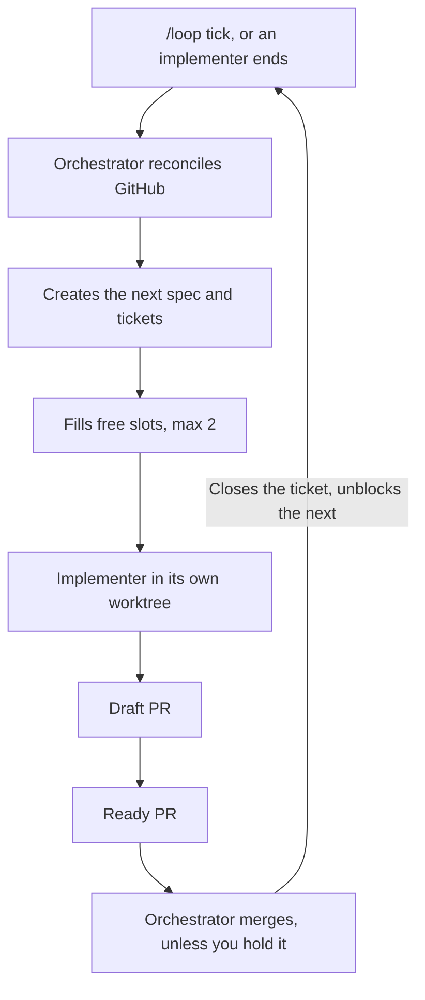

# Factory

The factory works through [PLAN.md](../PLAN.md) unattended. One orchestrator session turns the plan into tickets, and at most two implementers build them. The orchestrator merges ready PRs unless you say otherwise.

## Start

1. Finish or stop any other session working in this repo, or the orchestrator counts it as a slot.
2. Open a session in the main checkout in auto mode.
3. Send:

```text
/loop 15m Follow docs/factory/orchestrator.md
```

The app must stay open and the computer awake. A loop expires after 7 days. To resume, send the same command in a new session. The orchestrator picks up from GitHub and the pushed draft PRs.

The factory works on the first roadmap phase whose "Done when" criteria are not met. It stops when that phase is done, so you start each phase yourself.

## Files

| File | Purpose |
|---|---|
| [orchestrator.md](./orchestrator.md) | The steps for each loop tick |
| [implementer.md](./implementer.md) | The brief each implementer receives |

## Flow



## Roles

| Role | Runs as | Does | Never does |
|---|---|---|---|
| Orchestrator | The `/loop` session | Writes specs and tickets, dispatches, merges ready PRs, reports | Implements, changes the main checkout, or bypasses branch protection |
| Implementer | Background agent in a worktree | Builds one ticket, then ends | Works on another ticket or merges |
| You | | Make decisions, review what you choose to, and hold any merge | |

## Ticket states

GitHub holds all state, so a compacted or restarted orchestrator loses nothing.

| State | Detected by | Orchestrator action |
|---|---|---|
| Startable | `ready-for-agent`, unassigned, no open blockers | Claim and dispatch |
| Running | Assigned, with a live implementer | Leave it |
| Interrupted | Assigned or draft PR, with no live implementer | Dispatch on the same branch |
| Needs fixing | Ready PR with a failed required check, conflicts or requested changes | Dispatch on the same branch |
| Ready to merge | Ready PR with a passing required check | Merge it, unless it is held. It uses no slot |
| Needs a decision | `needs-info` or `ready-for-human` | Skip and report it |

## Design choices

- **Fresh context per ticket.** A `/loop` cannot compact or clear itself, so the orchestrator stays small and each implementer starts cold.
- **Tickets, not plan steps, are the unit of work.** Each one maps to one branch and one PR.
- **Claims survive restarts.** The issue assignee marks a claim, and the draft PR holds the work.
- **No stacked PRs.** Dependent tickets wait for a merge through blocked-by links.
- **Parallel work avoids conflicts.** Tickets running together share no files, including the lockfile, and at most one uses published Compose ports.

## Limits

- Not tested end to end yet, including background agents in worktrees.
- The docs do not say how a background agent handles a permission prompt. If an implementer ends after a denial, add a permission rule rather than retrying.
- `/loop` runs only in an open session. Fixing that needs another design, because implementers run inside the orchestrator's session.
